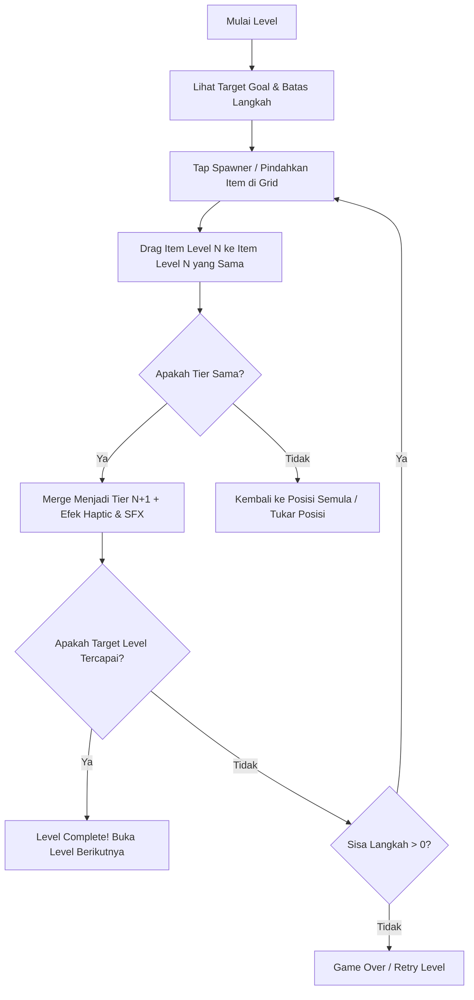

# Game Design Document (GDD): Gem Merge Quest

## 1. Ringkasan Konsep
* **Judul Sementara:** Gem Merge Quest (atau Crystal Bloom)
* **Genre:** 2D Casual Puzzle - Merge & Level Progression
* **Target Platform:** Android & iOS (Orientasi Layar: Portrait / Tegak)
* **Target Audience:** Kasual, pemain segala usia, menyukai puzzle relaksasi dengan sentuhan strategi ringan.

---

## 2. Core Game Loop

---

## 3. Hierarki Penggabungan (Merge Chain: Gemstones)

Pemain menggabungkan 2 batu permata dengan tingkatan yang sama untuk menghasilkan batu permata tingkat berikutnya:

| Tier | Nama Item | Warna / Visual | Skor Nilai | Keterangan |
|---|---|---|---|---|
| **Tier 1** | Rough Pebble | Abu-abu bertekstur | 10 pts | Item dasar yang sering muncul |
| **Tier 2** | Quartz Crystal | Putih bening | 25 pts | Kristal mentah sederhana |
| **Tier 3** | Green Jade | Hijau muda | 60 pts | Mulai berkilau |
| **Tier 4** | Lapis Lazuli | Biru pekat | 140 pts | Kristal dengan faset tajam |
| **Tier 5** | Amethyst | Ungu berpendar | 300 pts | Target level awal |
| **Tier 6** | Topaz | Emas / Oranye | 650 pts | Mulai memiliki aura partikel |
| **Tier 7** | Ruby | Merah delima | 1,400 pts | Batu permata mewah |
| **Tier 8** | Sapphire Royal | Biru safir bersinar | 3,000 pts | Target level menengah |
| **Tier 9** | Emerald Crown | Zamrud bertatah | 6,500 pts | Permata langka |
| **Tier 10** | Astral Diamond | Prisma pelangi berkilau | 15,000 pts | Tier tertinggi (Master Gem) |

---

## 4. Sistem Grid & Papan Permainan
* **Ukuran Grid:** 5 baris x 5 kolom (Total 25 petak) atau 6x6. Untuk game kasual mobile portrait, ukuran **5x5** adalah *sweet spot* yang tidak sempit di layar HP dan tidak membingungkan.
* **Tipe Petak (Tile Types):**
  1. **Empty Slot:** Petak kosong yang siap ditempati atau menerima drag item.
  2. **Active Item:** Petak yang sedang memuat Gemstone.
  3. **Locked / Blocked Slot:** Petak yang terkunci oleh batu/akar. Cara membukanya: lakukan merge di petak yang bersebelahan dengan petak terkunci.
  4. **Spawner Slot (Opsional):** Tombol generator untuk memunculkan item Tier 1 atau 2 baru dengan biaya 1 langkah.

---

## 5. Sistem Kemenangan & Kondisi Kalah
* **Kondisi Menang (Win Condition):**
  - Berhasil membuat item dengan tier target (misal: "Buat 1x Amethyst (Tier 5)").
  - ATAU mengumpulkan kombinasi target (misal: "Buat 2x Ruby (Tier 7)").
* **Kondisi Kalah (Fail Condition):**
  - Jumlah langkah (*Moves Limit*) habis sebelum target terpenuhi.
  - ATAU papan penuh (*Grid Deadlock*) dan tidak ada lagi langkah merge yang memungkinkan.

---

## 6. Aspek Mobile UX (Penting untuk Android & iOS)
* **Safe Area Handling:** Area atas (header HUD) diberi jarak aman untuk Dynamic Island / Kamera punch-hole. Area bawah diberi padding agar tidak bentrok dengan bar navigasi iPhone (Home Indicator) dan gesture Android.
* **Haptic Feedback:**
  - Getaran mikro (*Light impact*) saat mengangkat/melepaskan item.
  - Getaran sedang (*Medium impact*) saat berhasil menggabungkan batu (Merge).
  - Getaran ritmis (*Success pattern*) saat menang level.
* **Audio Feedback:** Efek suara pop yang nadanya naik setiap tier meningkat.
