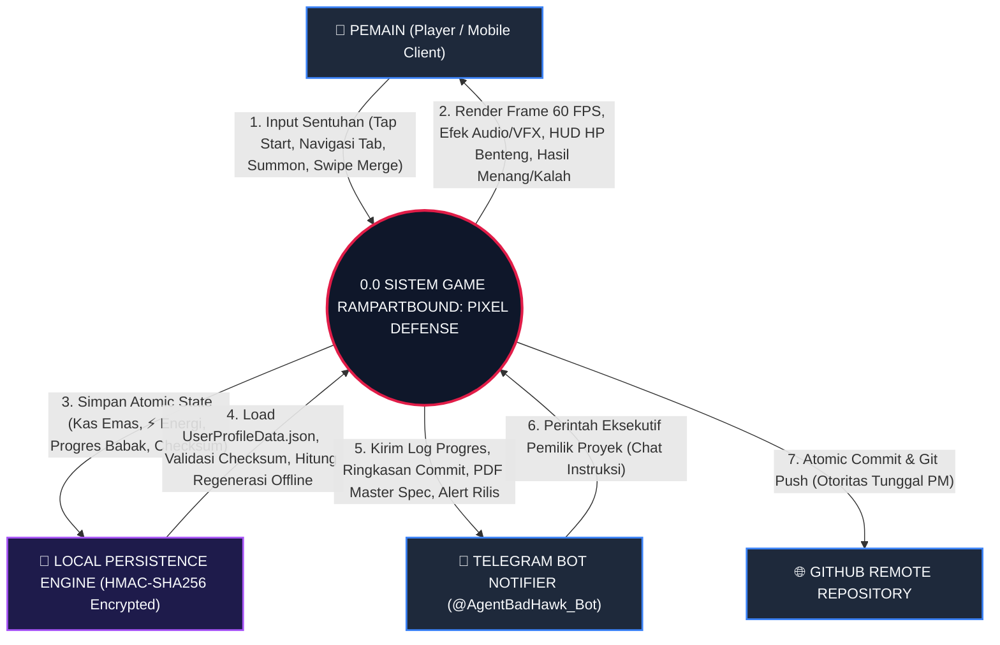
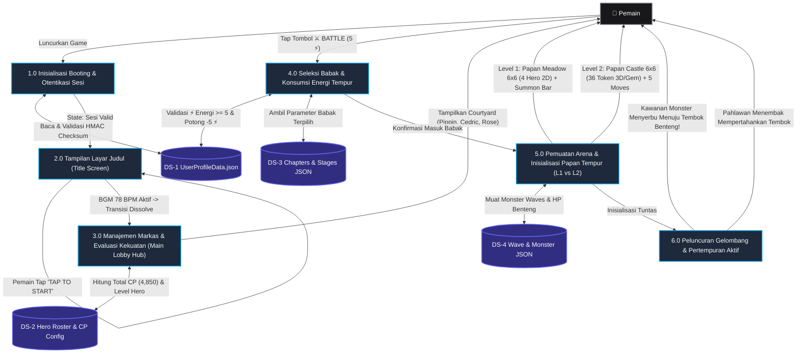
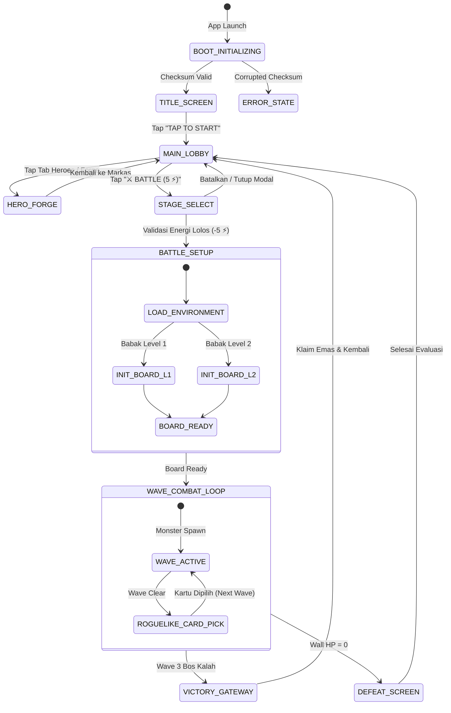

# 🛡️ RAMPARTBOUND: PIXEL DEFENSE
## Dokumen Spesifikasi Induk Produksi: Struktur Tim Studio & Alur QA, Desain Karakter 2D Menyeluruh & Ikon Orisinil, Desain Antarmuka Mobile, Cetak Biru Medan Tempur (SupaMerge Webzen), & DFD Level 0–1 Alur Sistem (SSOT)
**Single Source of Truth (SSOT) Master Specification Document**  
**Versi:** 2.14.0 (Official Release: Rekonstruksi Master Mockup 3, 4, & 5 Tanpa Tambal-Sulam, Integrasi Kanonikal Tongkat Kristal Pippin, Papan Teka-Teki Border Batu Kastil Baku, & Platform Dual Bastion Cannons Palisade)  
**Format Berkas Tersedia:** Microsoft Word (`.docx`), Adobe PDF (`.pdf`), dan Markdown Git (`.md`)  
**Pilihan Gaya Visual Resmi:** **OPSI A: Soft-Shaded Chibi Anime Fantasy (Resmi Disahkan Pemilik Proyek)**  
**Penyusun:** Studio Lead / Project Manager (`project_manager`) bersama Business & System Analyst (`system_analyst`), UX Specialist & UI Designer (`ux_specialist`), Character Artist (`character_artist`), Game Designer (`game_designer`), dan Divisi Engineering.

---

## DAFTAR ISI & STRUKTUR INDUK DOKUMEN

| No | Bab & Topik Spesifikasi | Cakupan Lingkup Teknis | Nomor Halaman Dokumen PDF |
|---|---|---|---|
| 1 | **[Visi, Misi, & Pilar Inti Game](#1-visi-misi--pilar-inti-game)** | Game Vision, Development Mission, 4 Pilar Desain, & Kamus Gaya "Soft-Shaded Chibi Anime Fantasy" | Halaman 3 |
| 2 | **[Struktur Tim Studio, Alur Kerja 5-Tahap, & Protokol Defect Loop Dual QA](#2-struktur-tim-studio-alur-kerja-5-tahap--protokol-defect-loop-dual-qa)** | Hierarki 12 Divisi Studio, Alur Pengarahan hingga Rilis, Matriks QA Gatekeeper, & Hak Git PM | Halaman 4 |
| 3 | **[Spesifikasi Karakter 2D Lengkap, In-Game ICON Resmi, & Bestiary Orisinil](#3-spesifikasi-karakter-2d-lengkap-in-game-icon-resmi--bestiary-orisinil)** | Concept Art Pippin, Cedric, Commander Rose, Companion Ignis & Barney, Evolusi Token Timbul & Permata T0 | Halaman 5 |
| 4 | **[Cetak Biru Desain Antarmuka Mobile, Peta Medan Tempur, & Dialog Pop-Up](#4-cetak-biru-desain-antarmuka-mobile-peta-medan-tempur--dialog-pop-up)** | Gambar 1 (Title), Gambar 2 (Lobby), Gambar 3 (Level 1 Outpost), Gambar 4 (Level 2 Teka-Teki) & Gambar 5 (Level 2 Serang), Modal Roguelike & Victory | Halaman 8 |
| 5 | **[Arsitektur Alur Sistem, DFD Level 0–1, & Siklus Pengalaman Pemain](#5-arsitektur-alur-sistem-dfd-level-01--siklus-pengalaman-pemain-start-hingga-game-dimulai)** | DFD Level 0 (Diagram Konteks Global) & DFD Level 1 (5 Sub-Proses End-to-End dari Start hingga Gameplay Dimulai) | Halaman 11 |
| 6 | **[Sistem UI/UX, Ergonomi Mobile, & Tata Letak Multi-Platform](#6-sistem-uiux-ergonomi-mobile--tata-letak-multi-platform)** | Ergonomi Jempol Navigasi Vertikal (Thumb-Zone), Safe Area Notch/Punch-Hole, & Zero Overlap Layout | Halaman 14 |
| 7 | **[Mekanik Permainan & Perbandingan Level 1 vs Level 2](#7-mekanik-permainan--perbandingan-level-1-vs-level-2)** | Formula Kerusakan Combat Power, Mekanik Gabung Petak 6x6, & Perbandingan Level 1 Arcade vs Level 2 Dual-Fase | Halaman 15 |
| 8 | **[Sistem Ekonomi Kerajaan (Kebijakan Zero Roti & Kayu)](#8-sistem-ekonomi-kerajaan-kebijakan-zero-roti--kayu)** | Penghapusan Total Roti & Kayu Palsu, Standar Murni ⚡ Energi (30/30) & 🪙 Koin Emas, serta Siklus Pengeluaran | Halaman 16 |
| 9 | **[Kamus Data Pemain & Arsitektur Teknis Database](#9-kamus-data-pemain--arsitektur-teknis-database)** | Struktur Data Profil Savegame JSON, Enkripsi Anti-Cheat HMAC-SHA256, & Kesiapan Backend Supabase/PlayFab | Halaman 17 |
| 10 | **[Desain Audio, Efek Suara (SFX), & Sensasi Bermain (Juice Feel)](#10-desain-audio-efek-suara-sfx--sensasi-bermain-juice-feel)** | Musik Akustik Medieval Lute Harpa 78 BPM, Pop-Scale Haptics, Floating Damage Numbers, & Screen Shake | Halaman 18 |
| 11 | **[Laporan Resolusi Kesenjangan Desain (Gap Resolution Report)](#11-laporan-resolusi-kesenjangan-desain-gap-resolution-report)** | Audit Penutupan Celah Desain 1 hingga 10: Karakter 2D Asli, Bestiary, Gameplay Mobile, Dual QA, & Rekonstruksi Mockup 3–5 Zero Patchwork v2.14.0 | Halaman 19 |
| 12 | **[Pengesahan Keputusan Arah Seni & Roadmap Produksi Studio](#12-pengesahan-keputusan-arah-seni--roadmap-produksi-studio)** | Pengesahan Opsi A Chibi Anime oleh Pemilik Proyek & Roadmap Eksekusi Sprint 1 hingga Sprint 4 Menuju Peluncuran | Halaman 20 |

---

## 1. Visi, Misi, & Pilar Inti Game

### 1.1 Visi Game (*Game Vision*)
> *"Menghadirkan perpaduan inovatif antara kepuasan teka-teki gabung petak (Tactile Merge & Match-3+ Puzzle) dengan ketegangan strategi pertahanan benteng (Tower Defense) bertema medieval-fantasi ceria yang adiktif, nyaman dimainkan dengan satu jempol, didukung estetika Soft-Shaded Chibi Anime Fantasy (Opsi A) yang memukau, serta alunan musik akustik menenangkan yang bebas stres."*

### 1.2 Misi Pengembangan (*Development Mission*)
1. **Sensasi Taktil Memuaskan (*Tactile Merge Juice*):** Menghadirkan kepuasan instan saat pemain menggabungkan pahlawan kembar (*pop merge feel*), evolusi bertingkat di atas papan catur pertahanan, serta ledakan proyektil pertahanan benteng.
2. **Kenyamanan Bermain Jangka Panjang (*Pacing & Ergonomi*):** Menghilangkan frustrasi pemain melalui navigasi vertikal satu tangan (*portrait thumb-zone*), tata letak bebas tabrakan (*zero UI overlap*) di ponsel panjang maupun tablet iPad, serta musik akustik santai yang mencegah kelelahan telinga.
3. **Ekonomi Bersih, Jujur, & Tanpa Tipuan (*Zero Wood & Bread Policy*):** Menghapus total 100% seluruh aset palsu (roti, gandum, dan kayu yang membingungkan pemain) dan menerapkan sistem stamina tempur **⚡ Energi (30/30, biaya 5 per laga)** dan **🪙 Koin Emas** yang transparan dan adil.
4. **Karakter Orisinil & Penuh Identitas (100% Original Character Concept Art & Icons):** Bukan sekadar mengambil aset lama atau menempelkan emoji! Seluruh pahlawan dan maskot dirancang orisinil dengan lembar konsep seni 2D beresolusi tinggi (896x1200 dan 1376x768): **Pippin sang Astral Runemage**, **Cedric sang Emberblade Vanguard**, **Commander Rose sang Sunforged Aegis**, **Ignis sang Burung Hantu Api**, dan **Barney sang Landak Perisai Baja**.
5. **Fondasi Produksi Komersial:** Menerapkan arsitektur data anti-cheat lokal (atomic swap + HMAC-SHA256) yang siap disambungkan ke backend cloud (Supabase / PlayFab) untuk peluncuran massal.

### 1.3 Empat Pilar Desain Utama
| 1. Tactile Merge Satisfaction | 2. Real-Time Tower Defense | 3. Chibi Anime & Peaceful Vibe | 4. Zero-Friction Economy |
|---|---|---|---|
| Kepuasan visual, audio arpeggio, dan getaran haptic saat unit pahlawan menyatu dan naik tier di papan grid. | Ketegangan taktis mempertahankan gerbang palisade dari serbuan kawanan monster (Gemetite Ooze, Mire Scrapper, Demon, Behemoth). | Gaya visual Soft-Shaded Chibi Anime Fantasy (Opsi A), musik akustik petikan kecapi 78 BPM, dan warna medieval hangat. | Murni menggunakan ⚡ Energi (biaya 5 per laga) & 🪙 Emas. Tanpa item dummy roti maupun kayu. |

### 1.4 Kamus & Standar Gaya Seni Resmi: "Soft-Shaded Chibi Anime Fantasy"
* **Nama Gaya Seni Resmi:** **"Soft-Shaded Chibi Anime Fantasy"** (dikenal di industri game mobile sebagai *Korean / Japanese Chibi Fantasy RPG Style* atau *Super-Deformed (SD) Anime*).
* **Karakteristik Visual Utama (Identik dengan Title Screen):**
  1. **Proporsi Tubuh:** Chibi 2.5 hingga 3 kepala. Kepala bulat dengan pipi tembem menggemaskan (*chubby cheeks*), mata anime besar berbinar penuh ekspresi (*sparkling expressive eyes*), serta postur tubuh mungil yang ramah pemain kasual.
  2. **Teknik Pewarnaan:** *Soft Cel-Shading* dengan gradasi halus, pencahayaan hangat (*warm fairy-tale rim-lighting*), dan garis tepi (*lineart*) bersih dan tajam.
  3. **Aksen & Ornamen:** Bingkai emas medieval (*filigree gold trim*), permata sudut berkilau, dan partikel sihir lembut.
  4. **Benchmark Industri Serupa:** *Guardian Tales* (art potret pahlawan), *MapleStory*, *Line Rangers*, *Cookie Run: Kingdom*, *Bravely Default*, dan stiker anime *Genshin Impact*.

---

## 2. Struktur Tim Studio, Alur Kerja 5-Tahap, & Protokol Defect Loop Dual QA

### 2.1 Struktur Organisasi Tim Studio (Bagan Hierarki Visual)
| Tingkat Hierarki | Peran & Divisi | Tanggung Jawab & Garis Komando |
|---|---|---|
| **TIER 1: PEMILIK PROYEK / USER** | Pemilik Proyek / Eksekutif | Pemberi mandat utama, penentu visi komersial, pengarah fitur baru, dan penilai kualitas akhir. Berkomunikasi secara langsung hanya melalui Single Point of Contact (Project Manager). |
| **TIER 2: STUDIO LEADERSHIP** | `project_manager` (Studio Lead / PM) `system_analyst` (BA / SA) | **PM:** Executive SPOC, pengawas 12 agen, dan **Pemegang Otoritas Tunggal Git Push** ke remote GitHub. **BA/SA:** Penyusun Spec Sheet teknis, kamus data JSON, dan arsitektur runtime. |
| **TIER 3A: DIVISI CREATIVE & ART** | `ux_specialist` `character_artist` `environment_map_artist` `ui_designer` `game_designer` | **UX:** Kenyamanan jempol & zero UI overlap. **Character Artist:** Desain karakter 2D penuh & in-game icon token. **Environment Artist:** Peta medan tempur 2.5D & World Map. **UI Designer:** Antarmuka Glassmorphism & tombol 3D empuk. **Game Designer:** Formula Core Loop, merge, & perk roguelike. |
| **TIER 3B: DIVISI ENGINEERING & AUDIO** | `game_developer` `level_balancer` `audio_vfx_specialist` | **Core Dev:** Pemrograman C# Unity (Bootstrapper, Grid, Combat, Save DB). **Balancer:** Konfigurasi JSON HP monster, gelombang, koin, & limit 5 langkah. **Audio/VFX:** BGM akustik 78 BPM, SFX tembakan/merge, partikel, & haptic juice feel. |
| **TIER 4: DUAL QA VERIFICATION GATE** | `qa_functional_gatekeeper` `qa_visual_auditor` | **QA Fungsional:** Audit logika C#, spawner monster, validasi kondisi menang/kalah (anti auto-win), & integritas atomic save. **QA Visual:** Audit zero UI overlap, proporsi kanvas tablet iPad, kontras warna, & konsistensi estetika Chibi Anime Opsi A. |
| **TIER 5: RELEASE & COMMIT** | `project_manager` | Eksekusi atomic commit dan `git push origin` ke remote repository GitHub setelah sertifikasi Dual QA 100% PASS disahkan. |

### 2.2 Protokol Defect Feedback Loop: Apakah QA Mengembalikan Tiket Jika Tidak Pass?
> **JAWABAN EKSEKUTIF: YA, 100% MUTLAK!**  
> Sesuai prinsip **Anti-Bypass QA Gate** di `AGENTS.md`, jika suatu deliverable tidak memenuhi standar kelulusan QA, proses rilis dihentikan seketika dan tiket **WAJIB DIKEMBALIKAN** ke divisi terkait:
> 1. Jika **`qa_functional_gatekeeper`** menemukan bug logika/state $\rightarrow$ Tiket ditolak (*FAIL*) dan dikembalikan ke **Divisi Engineering** (`game_developer` atau `level_balancer`) untuk diperbaiki.
> 2. Jika **`qa_visual_auditor`** menemukan overlap UI, layout pecah, atau inkonsistensi seni $\rightarrow$ Tiket ditolak (*FAIL*) dan dikembalikan ke **Divisi Creative & Art** (`ui_designer` atau `character_artist`).
> 3. **Project Manager DILARANG KERAS** melakukan commit release atau `git push` sebelum kedua auditor memberikan stempel **100% DUAL PASS**.

### 2.3 Protokol Validasi Khusus Dokumen Spesifikasi: Wewenang BA & PM
> **ATURAN MUTLAK DOKUMENTASI:**  
> Untuk perbaikan dan pembaruan dokumen spesifikasi teknis / GDD, diskusi antar tim terbuka secara kolaboratif. Namun, **yang berhak memvalidasi akhir dan memberikan pengesahan untuk commit serta Git Push adalah Business Analyst (`system_analyst`) dan Project Manager (`project_manager`)**, **BUKAN QA**.  
> Divisi QA memegang peranan pengujian fungsional kode runtime dan estetika kanvas build game. Setiap revisi besar dokumen wajib dinaikkan versinya (misal v2.5.0 ke v2.6.0) agar rekaman riwayat desain tetap terlindungi.

---

## 3. Spesifikasi Karakter 2D Lengkap, In-Game ICON Resmi, & Bestiary Orisinil

### 3.0 Lembar Master T0 Gems, Evolusi Zirah Token 3D Timbul, & Acuan Terkunci
*File: `Rampartbound/Assets/Art/chibi_armor_evolution_and_gems_sheet.jpg`*  
Menjawab arahan pemilik proyek agar upgrade pahlawan **tidak sekadar menambahkan bintang, melainkan menampilkan evolusi zirah, senjata, dan wujud pahlawan secara visual**, serta menghadirkan **Permata Mentah T0 (Bintang 0)** sebelum bermutasi menjadi token pahlawan bertaraf 3D timbul (*embossed relief*):

1. **Acuan Visual Terkunci (Locked Canonical Benchmark dari Main Lobby):**
   * Desain ketiga karakter pada layar Main Lobby (`lobby_mockup_redesign.jpg`) adalah standar visual kanonik mutlak yang telah **DIKUNCI RESMI SEBAGAI ACUAN TUNGGAL SELURUH ASET**:
     - **Pippin:** Kelinci putih penyihir berbulu lebat, telinga panjang terkulai, jubah & topi biru bergesper matahari, tongkat kristal safir, menghadap sudut 3/4 kanan.
     - **Cedric:** Ksatria cilik berwajah bulat imut, tudung merah delima (*crimson hooded cloak*), zirah dada perak, pedang & perisai layang perak, menghadap sudut 3/4 kanan.
     - **Commander Rose:** Ksatria putri paladin cilik berambut **merah muda cerah (*bubblegum pink*) dikuncir kuda tinggi megah (BUKAN PIRANG!)**, zirah pelat perak-emas bermotif mawar surya, palu perang surya emas raksasa, menghadap sudut 3/4 kanan.
2. **Aturan Wajib Konsistensi Sudut Hadap Token (Strict Facing Direction Consistency):**
   * Sesuai instruksi mutlak Pemilik Proyek (*"untuk token jika 1 character hadap kanan, hadap kanan semua konsisten!"*), setiap karakter wajib memiliki sudut hadap yang seragam di seluruh tingkatan (Tier 1 Perunggu, Tier 2 Perak, Tier 3 Emas):
     - Seluruh token Pippin konsisten menghadap 3/4 kanan di Tier 1, 2, dan 3.
     - Seluruh token Cedric konsisten menghadap 3/4 kanan di Tier 1, 2, dan 3.
     - Seluruh token Commander Rose konsisten menghadap 3/4 kanan di Tier 1, 2, dan 3.
     - **Dilarang membalik/mirroring arah hadap antar-tier atau membuat sudut pandang yang bertolak belakang.**
3. **Pemisahan Fokus Desain Karakter (Anti-Cropping Clutter):**
   * Desain karakter pada Bab 3.1–3.3 difokuskan 100% pada karya seni pahlawan penuh dan HUD Avatar resmi tanpa memotong/mencatut potongan token kecil ke dalam boks profil pahlawan. Seluruh matriks evolusi token dipusatkan secara eksklusif pada lembar master Bab 3.0.
4. **Permata Mentah T0 (Bintang 0 / Raw Elemental Gemstones):**
   * **Pippin T0 (*Astral Sapphire Gem*):** Kristal faset biru safir heksagonal bercahaya mistis dengan pendaran rune celestial safir biru.
   * **Cedric T0 (*Ember Ruby Gem*):** Kristal faset merah delima menyala dengan retakan magma berpendar bara api panas.
   * **Commander Rose T0 (*Rose Quartz Pink Gem*):** Kristal faset merah muda (**Pink**) bercahaya anggun dan lembut, memancarkan aura suci mawar faset pelindung (*100% selaras dengan instruksi resmi Pemilik Proyek agar permata Rose menggunakan warna Pink*).
5. **Efek Token 3D Timbul (*Embossed Tactile Depth*):**
   * Token bukan koin 2D pipih! Seluruh medali dicetak dengan bevel melengkung tebal, bayangan jatuh diegetik (*drop shadow*), dan bingkai logam tempa timbul sehingga tampak mewah dan berbobot saat diletakkan di atas petak papan tempur.
6. **Pohon Evolusi Visual Zirah & Senjata:**
   * **Pippin (Kelinci Putih Penyihir Chibi):**
     - Tier 1: Figur kelinci putih bertelinga panjang terkulai, topi kerucut biru & jubah apprentice sederhana, tongkat sihir kayu.
     - Tier 2: Pippin dengan pelindung bahu perak, jubah rasi bintang berkilau, dan tongkat permata safir berenergi.
     - Tier 3: Jubah agung Archmage Celestial bersulam emas filigree, orbe astral melayang, dan tongkat kristal raksasa bercahaya halo.
   * **Cedric (Ksatria Cilik Bertudung Merah):**
     - Tier 1: Cedric dengan tudung merah delima khas Title Screen, tunik kulit, dan pedang pendek besi.
     - Tier 2: Zirah dada baja tempa, mantel merah menyala, dan pedang bara api (*Flame Broadsword*).
     - Tier 3: Zirah ksatria naga emas penuh (*Dragon-Knight Gold Plate*), sayap pelindung berapi, dan pedang agung membara.
   * **Commander Rose (Ksatria Putri Berambut Merah Muda / Vibrant Pink Hair Kuncir Kuda):**
     - Tier 1: Rambut pink cerah dikuncir kuda tinggi, tunik ksatria pelat ringan, dan palu tempa standar.
     - Tier 2: Rambut pink kuncir kuda, zirah pelat dada perak-merah muda diperkuat, pelindung bahu kepala singa, dan palu suci bercahaya.
     - Tier 3: Rambut pink kuncir kuda, zirah pelat emas kerajaan bersayap malaikat agung (*Winged Royal Sunforged Plate*), tiara mahkota emas, dan Palu Perang Surya raksasa bertatahkan kristal mawar pink bercahaya.

### Lembar Master Aset In-Game HUD Badges & Token Papan Tempur
*File: `Rampartbound/Assets/Art/Sprites/chibi_character_icons_sheet.jpg`*  
Menampilkan 6 medali circular avatar badges berkualitas tinggi (gaya Chibi Guardian Tales / MapleStory): **Pippin** (celestial emas), **Cedric** (tembaga runik), **Rose** (perak & mawar emas), **Ignis** (roda gigi perunggu), **Barney** (baja daun ek), dan **Gemetite** (kristal zamrud hijau).

### 3.1 PIPPIN, THE ASTRAL RUNEMAGE (Chrono-Bunny Scholar)
* **Karya Seni Konsep 2D Penuh (`Rampartbound/Assets/Art/Characters/char_pippin_concept.jpg`):**  
  Ilustrasi studio beresolusi 896 &times; 1200 px: **100% Selaras dengan Title Screen & Main Lobby!** Kelinci putih menggemaskan berbulu salju lebat dengan telinga panjang terkulai lembut, mata anime safir bulat berbinar penuh rasa ingin tahu, dan pipi merona merah muda. Mengenakan topi kerucut biru royal berhiaskan gesper matahari emas, jubah biru royal bertepikan sulaman rasi bintang emas, sabuk kulit pembawa kantong rune, serta menggenggam tongkat kayu berspiral dengan puncak bola api mistis keemasan yang melayang lembut. Menghadap sudut 3/4 kanan.
* **In-Game HUD Avatar Badge (`Rampartbound/Assets/Art/Sprites/icon_pippin_runemage.png`):**  
  Medali emas celestial melingkar bertatahkan safir biru dengan potret kepala Pippin tersenyum ramah (transparan PNG).
* **Token Papan Tempur 3D Timbul:**  
  Tingkatan token Pippin (Tier 1 Perunggu, Tier 2 Perak, Tier 3 Emas) diatur terpusat di lembar evolusi Bab 3.0 dan wajib konsisten menghadap sudut 3/4 kanan.
* **Peran Tempur:** Arcane Ranged Nuker (75 DMG, 1.05s). Mempercepat putaran kristal Arcane Cube dan meluncurkan proyektil percikan sihir berarea.

### 3.2 CEDRIC, THE EMBERBLADE VANGUARD (Crimson Spellblade Scout)
* **Karya Seni Konsep 2D Penuh (`Rampartbound/Assets/Art/Characters/char_cedric_concept.jpg`):**  
  Ilustrasi studio beresolusi 896 &times; 1200 px: **100% Selaras dengan Title Screen & Main Lobby!** Didesain ulang total menjadi proporsi Chibi 2.8 kepala menggemaskan: Wajah bulat imut, mata anime cokelat/biru berbinar, rambut cokelat lembut. Mengenakan jubah bertudung merah delima menyala (*crimson hooded cloak*), pelindung dada baja perak ringan di atas doublet gelap, sarung tangan pelindung, dan sepatu bot ksatria mini. Memegang pedang pendek perak berpercik bara api di tangan kanan dan perisai layang perak berbingkai emas di tangan kiri. Menghadap sudut 3/4 kanan.
* **In-Game HUD Avatar Badge (`Rampartbound/Assets/Art/Sprites/icon_cedric_emberblade.png`):**  
  Medali tembaga runik berlatar siluet kastil fajar dengan potret kepala Cedric tersenyum gagah (transparan PNG).
* **Token Papan Tempur 3D Timbul:**  
  Tingkatan token Cedric (Tier 1 Perunggu, Tier 2 Perak, Tier 3 Emas) diatur terpusat di lembar evolusi Bab 3.0 dan wajib konsisten menghadap sudut 3/4 kanan.
* **Peran Tempur:** Frontline Spellblade Melee (42 DMG ganda, 0.65s). Menahan serbuan monster garis depan dengan tebasan cepat dan efek bakar (*Burn DoT*).

### 3.3 COMMANDER ROSE, THE SUNFORGED AEGIS (Supreme Paladin & Grand Forgemaster)
* **Karya Seni Konsep 2D Penuh (`Rampartbound/Assets/Art/Characters/char_rose_concept.jpg`):**  
  Ilustrasi studio beresolusi 896 &times; 1200 px: **100% Selaras dengan Main Lobby Terkunci!** Figur ksatria cilik wanita berproporsi Chibi ~2.8 kepala yang manis dan anggun, selaras sempurna dengan Pippin dan Cedric. Memiliki mata anime violet besar berbinar, **rambut merah muda (*bubblegum pink*) dikuncir kuda tinggi megah dengan poni pink imut (Bukan Pirang!)** serta tiara perak mini. Mengenakan zirah pelat baja perak-emas yang imut berukir lambang mawar surya di dada, jubah mini melambai, dan memegang Palu Perang Surya Emas raksasa (*Sunforged Warhammer*) bertatahkan kristal mawar bercahaya merah muda. Menghadap sudut 3/4 kanan.
* **In-Game HUD Avatar Badge (`Rampartbound/Assets/Art/Sprites/icon_rose_sunforged.png`):**  
  Medali perisai perak berukir bunga mawar emas dengan potret wajah ceria Rose berambut pink (transparan PNG).
* **Token Papan Tempur 3D Timbul:**  
  Tingkatan token Rose (Tier 1 Perunggu, Tier 2 Perak, Tier 3 Emas) diatur terpusat di lembar evolusi Bab 3.0 dan wajib konsisten menghadap sudut 3/4 kanan.
* **Peran Tempur:** Supreme Paladin Tanker (55 DMG Area Splash, 0.85s). Berdiri kokoh di podium pusat tembok benteng dan memberikan buff +15% HP pertahanan benteng.

### 3.4 & 3.5 MASKOT & PENDUKUNG TIM (100% Karakter Orisinil Baru Pengganti Ayam & Kucing Generik)
* **Lembar Desain Konsep 2D Asli (`Rampartbound/Assets/Art/Characters/char_companions_concept.jpg`):**  
  Ilustrasi studio beresolusi 1376 &times; 768 px menampilkan Ignis dan Barnaby berdampingan:
  - **3.4 IGNIS, THE PYRE OWL SENTINEL (`icon_ignis_owl.png`):** Burung hantu kerdil mekanik berbulu cokelat keemasan, berkacamata optik tembaga ganda (*brass goggles*), topi penerbang kulit mini, dan mencengkeram sangkar lentera yang menyimpan lidah api suci abadi (*Eternal Hearthfire*). Buff: +15% Kecepatan Tembak Meriam Palisade.
  - **3.5 BARNABY "BARNEY", THE BULWARK PORTER (`icon_barney_hedgehog.png`):** Landak ksatria mini berpostur bulat gempal, helm tempur besi kerdil berpelindung hidung, ransel kayu pengangkut peluru meriam, serta perisai daun baja di punggung durinya. Buff: Memulihkan +10 HP Tembok Palisade setiap gelombang monster bersih.

### 3.6 Bestiary Kawanan Monster & Bos (100% Orisinil Chibi Anime Style)
* **Lembar Desain Konsep Bestiary Chibi Asli (`Rampartbound/Assets/Art/Characters/monster_concepts.jpg`):**  
  Ilustrasi studio beresolusi 1376 &times; 768 px menampilkan 4 monster resmi Rampartbound dalam gaya **Soft-Shaded Chibi Anime Fantasy** yang serasi 100% dengan pahlawan di Title Screen:
  - **GEMETITE CRYSTAL OOZE (`icon_monster_gemetite.png`):** Slime kristal hijau bulat menggemaskan seperti jeli berwajah senyum ceria, pipi merona, dengan ransel pecahan kristal zamrud berkilau di punggungnya. HP: 90–180, SPD: 1.15 u/s. Pecah menyebar kristal berduri saat mati.
  - **MIRE HORNED SCRAPPER (`icon_monster_mire_scrapper.png`):** Monster kadal rawa kerdil imut bertopeng kumbang bertanduk mini, membawa rantai jangkar kapal kecil (*Salvaged Anchor Flail*). HP: 140–260, SPD: 1.45 u/s. Menangkis tembakan panah pertama.
  - **ABYSSAL OBSIDIAN MAW (`icon_monster_obsidian_maw.png`):** Monster batu magma gempal/chubby berkaki pendek dengan retakan lahar berapi dan kapak batu lava. HP: 450–950, SPD: 0.75 u/s, Reward: 40G. Skill: *Earthquake Slam* (-15 HP benteng) dan resistensi 30% ledakan meriam.
  - **MALAKOR, THE VOID TYRANT (`icon_monster_malakor_boss.png`):** World Boss (Wave 3). Mini-overlord kegelapan bertanduk kehampaan dan mata cyan bulat bercahaya, bertubuh chibi melayang dengan jubah ungu gelap. HP: 2,500–5,000, SPD: 0.45 u/s, Reward: 300G. Skill: *Aura Gravitasi* (-20% laju proyektil pertahanan) dan *Enrage Void Minion Summons*.

---

## 4. Cetak Biru Desain Antarmuka Mobile, Peta Medan Tempur, & Dialog Pop-Up

### 4.1 Gambar 1: Layar Judul Asli (Title Screen) — Start Screen Favorit Pemain
*File: `Rampartbound/Assets/Art/TitleScreen.jpg`*  
Layar pembuka asli Rampartbound: Kastil Aethelgard megah di bawah langit biru cerah, Pippin sang Kelinci Penyihir di sisi kiri, Cedric sang Ksatria Bertudung Merah di sisi kanan, dan tombol emas presisi **"TAP TO START"** dengan kursor tangan.

### 4.2 Gambar 2: Layar Utama Main Lobby & Courtyard Pahlawan (Redesain Resmi Chibi Anime)
*File: `Rampartbound/Assets/Art/lobby_mockup_redesign.jpg`*  
Menindaklanjuti instruksi resmi Pemilik Proyek untuk **menghapus Gambar 2A dan 2B (karena referensi lama tidak sesuai dan masih membawa elemen game lain)**, studio telah mendesain ulang antarmuka Main Lobby secara total menjadi cetak biru visual 9:16 yang memadukan pahlawan orisinil berestetika **Soft-Shaded Chibi Anime Fantasy**:
1. **Top Header Zone (Y: 0–110 px):** Safe Area Notch, badge mahkota **🏰 Citadel Lv.8**, meteran stamina **⚡ Energy 30/30**, kas kerajaan **🪙 Gold 500** (100% bersih dari roti & kayu), serta spanduk total kekuatan tim: **⚡ TEAM CP: 4,850**.
2. **Courtyard & Hero Assembly Zone (Y: 110–740 px):** Pemandangan megah Citadel of Aethelgard di bawah langit cerah. Formasi 3 pahlawan Chibi berkumpul riang di pelataran istana:
   - **Pippin (Kelinci Putih Title Screen):** Lencana info mengambang di bawahnya: `Lv.12 | CP 1,600`
   - **Cedric (Ksatria Bertudung Merah Title Screen):** Lencana info mengambang di bawahnya: `Lv.15 | CP 1,850`
   - **Commander Rose (Ksatria Putri Berambut Pink Kuncir Kuda):** Lencana info mengambang di bawahnya: `Lv.14 | CP 1,400`
3. **Primary Action Zone (Y: 740–860 px):** Tombol merah besar 3D mengkilap **"⚔️ BATTLE (5 ⚡)"** dengan bingkai emas melengkung (*filigree gold trim*) yang memicu pemilihan babak (Level 1 / 2).
4. **Bottom Navigation Tab Bar (Y: 860–960 px):** 4 Tab navigasi beraksen emas medieval: [🏰 Citadel] [🔨 Forge] [👥 Heroes] [🎒 Bag].

### 4.3 Cetak Biru Medan Tempur & Antarmuka Gameplay: Level 1 vs Level 2

Sesuai arahan resmi Pemilik Proyek, gameplay Level 1 dan Level 2 memiliki arsitektur mekanik dan tampilan arena yang berbeda secara fundamental:

#### 1. Gambar 3: Level 1 — Outpost Defense (Arcade Real-Time Battle Langsung)
*File: `Rampartbound/Assets/Art/gameplay_l1_outpost_mockup.jpg`* *(Karya Seni Resmi Disahkan Pemilik Proyek [Eks Gambar 3B])*  
* **Konsep Papan Tempur 6x6 Meadow:** Papan catur rumput meadow. **BUKAN TOKEN! Karakter yang berada di petak adalah figur 2D Chibi penuh yang langsung berdiri, bergerak, dan menembak proyektil/sihir ke arah atas!**
* **Aturan Penempatan Unit:** **100% SELURUH PAHLAWAN BERADA DI DALAM KOTAK PAPAN 6x6!** Tidak ada karakter yang berdiri terpisah di luar grid atau di atas tembok benteng.
* **Alur Penyerbuan Monster Logis:** Kawanan monster (Chibi Gemetite slimes dan Mire scrappers) berbaris turun dari jalur medan tempur atas menuju Tembok Palisade Kayu. Tembok palisade kayu pasak dengan menara meriam kayu melindungi area pemain. Pahlawan menembak ke atas melintasi tembok untuk menghabisi monster sebelum palisade rusak.
* **Bilah Selektor Pahlawan Bawah (Mobile Summon Deck):**
  * Pippin (50 Gold) — Arcane bolts
  * Cedric (50 Gold) — Flame crescent slash
  * Commander Rose (60 Gold, Rambut Pink Kuncir Kuda) — Sacred solar smash
  * Arcane Cube kristal emas sebagai tombol pemanggil acak.
* **Mekanik Merge 2D Langsung:** Menyeret satu figur 2D ke figur 2D kembar langsung menyatukan keduanya menjadi figur 2D bertingkat zirah lebih tinggi (*Tier 2 Veteran / Tier 3 Champion*).

#### 2. Gambar 4: Level 2 — Fortress Siege: Fase 1 (In-Game Token Puzzle Mode)
*File: `Rampartbound/Assets/Art/gameplay_l2_puzzle_mockup.jpg`* *(Standardisasi SupaMerge Webzen [Eks Gambar 3A-1])*  
* **Konsep Papan:** Papan 6x6 berbingkai emas megah dengan ubin batu benteng terisi penuh 36 petak oleh **Token 3D Timbul Ber-Armor** (Pippin kelinci biru, Cedric ksatria merah, Rose ksatria pink) dan **Permata Mentah T0 (Blue Sapphire, Red Ruby, Rose Quartz Pink)**.
* **Indikator Langkah Taktis (Moves HUD):** Menampilkan spanduk emas bercahaya **"5 TACTICAL MOVES LEFT"** dengan 5 perisai emas.
* **Pertahanan Benteng Batu:** Tembok benteng batu granit kokoh dengan obor api membentengi area pemain dari kepungan kawanan Chibi Obsidian Maw magma golems di luar gerbang benteng saat pemain berpikir dan menukar petak.
* **Mekanik SupaMerge:** Pemain melakukan swap petak bersebelahan membentuk garis 3+ kembar untuk menggabungkan token/permata ke tier lebih tinggi. Efek gravitasi cascade mengisi petak kosong.

#### 3. Gambar 5: Level 2 — Fortress Siege: Fase 2 (Battle Attack Phase Saat Langkah Habis)
*File: `Rampartbound/Assets/Art/gameplay_l2_battle_mockup.jpg`* *(Serang Balik Tempur [Eks Gambar 3A-2])*  
* **Pemicu Fase Serang:** Begitu 5 langkah habis (*Moves: 0*), muncul spanduk mahkota bersayap emas **"⚔️ BATTLE PHASE ACTIVATED!"**.
* **Karakter 2D Berdiri di Atas Token:** Figur 2D Chibi pahlawan (Pippin kelinci penyihir, Cedric ksatria bara, Rose ksatria berambut pink kuncir kuda) **MUNCUL DAN BERDIRI TEGAK DI ATAS TOKEN-TOKEN MEREKA DI PAPAN!**
* **Serangan Serempak Melindungi Benteng:** Seluruh pahlawan serentak melepaskan tembakan sinar laser biru, tebasan pedang sabit berapi, dan hantaman Solar Smash palu surya yang menghujam kawanan monster magma (*Obsidian Maw*) dan Bos Kehampaan (*Malakor*) di gerbang benteng batu! Teks damage melayang (*CRIT! 2,450*) memancarkan sensasi kepuasan (*tactile juice*).

### 4.4 Sistem Desain Modal Pop-Up Interaktif Menawan (Delightful Modal UI Design System)
* **4.4.1 Modal Berkah Roguelike (Wave Victory Blessing):** Frame kayu ek berukir emas 3D, background obsidian gelap (blur 8px). Menampilkan 3 kartu tarot bersinar: `[⚡ SWIFT QUIVER]`, `[💥 HEAVY BALLISTICS]`, dan `[🛡️ FORTIFY PALISADE]`.
* **4.4.2 Modal Kemenangan Benteng (Royal Victory Gateway):** Mahkota kejayaan dengan 3 bintang emas 3D berputar, spanduk pita sutra merah bertuliskan *VICTORY!*, peti kas emas terbuka memancarkan koin +500 Gold / +800 Gold, serta tombol lebar *KLAIM HADIAH & KEMBALI KE LOBBY* dengan animasi kilau emas berkala.

---

## 5. Arsitektur Alur Sistem, DFD Level 0–1, & Siklus Pengalaman Pemain

### 5.1 DFD Level 0: Diagram Konteks Global (Context Diagram)

Diagram Konteks Level 0 memetakan batasan sistem utama *Rampartbound: Pixel Defense*, entitas eksternal yang berinteraksi dengannya, serta aliran data masuk dan keluar secara komprehensif.

#### Spesifikasi Entitas Eksternal & Aliran Data DFD Level 0:
1. **👤 PEMAIN (`Player`):** Sumber input interaktif utama melalui layar sentuh (Tap Start, perpindahan tab markas, pemilihan babak, dragging merge pahlawan, swap token). Menerima umpan balik audio-visual real-time (animasi Chibi, partikel ledakan proyektil, teks damage terapung, dialog berkah roguelike).
2. **💾 LOCAL PERSISTENCE ENGINE:** Modul penyimpanan aman berbasis file JSON terenkripsi (`UserProfileData.json`). Menjamin integritas data dari kecurangan lokal via tanda tangan HMAC-SHA256 dan atomic swap buffer (`.tmp`).
3. **🤖 TELEGRAM BOT NOTIFIER (`@AgentBadHawk_Bot`):** Pintu komunikasi eksekutif langsung antara sistem studio game dengan Pemilik Proyek (Aldy). Berfungsi mengirimkan dokumen spesifikasi PDF, alert rilis, serta menerima arahan strategis melalui daemon long-polling.
4. **🌐 GITHUB REMOTE REPOSITORY:** Repositori version control studio untuk sinkronisasi aset kode dan desain, dioperasikan eksklusif di bawah otoritas tunggal Project Manager.

---

### 5.2 DFD Level 1: Dekomposisi Fungsional Alur Game (Start hingga Game Dimulai)

Diagram ini menguraikan sistem proses internal mulai saat pemain menyentuh aplikasi hingga gelombang pertempuran resmi aktif di papan medan tempur:

#### Rincian Sub-Proses DFD Level 1 (Start hingga Game Dimulai):

| Sub-Proses | Nama Tahapan | Entitas & Data Store Terkait | Logika & Validasi Sistem | Output Visual / Audio |
|---|---|---|---|---|
| **1.0** | **Booting & Validasi Akun** | `DS-1: UserProfileData.json` | 1. Engine memuat data akun. 2. Validasi HMAC-SHA256 checksum. 3. Hitung regenerasi energi offline (+1 ⚡ / 8 menit). | Splash screen Unity -> Fade-in transisi 0.4 detik ke Title Screen. |
| **2.0** | **Layar Judul (Title Screen)** | `TitleScreen.jpg`, Akustik Audio Manager | 1. Alokasi tekstur GPU. 2. Putar BGM akustik 78 BPM. 3. Dengarkan sentuhan tombol **"TAP TO START"**. | Pippin & Cedric menyambut pemain, tombol emas berdenyut lembut, SFX arpeggio petikan kecapi saat di-tap. |
| **3.0** | **Manajemen Markas (Lobby Hub)** | `DS-1: UserProfileData`, `DS-2: Hero Roster` | 1. Sinkronisasi saldo kas (⚡ 30/30, 🪙 500G, zero roti/kayu). 2. Hitung total Combat Power: `Team CP = 4,850`. 3. Render 3 pahlawan Chibi di Courtyard bersama kartu level & CP individu. | Courtyard Citadel of Aethelgard cerah, tab navigasi emas empuk, tombol merah besar 3D **"⚔️ BATTLE (5 ⚡)"**. |
| **4.0** | **Seleksi Babak & Konsumsi Energi** | `DS-1: UserProfileData`, `DS-3: Chapters Stages` | 1. Deteksi babak yang dipilih (Level 1 Outpost vs Level 2 Fortress). 2. Validasi syarat stamina: `currentEnergy >= 5`. 3. Jika lolos: kurangi stamina `-5 ⚡` dan simpan atomik ke `DS-1`. | Transisi dissolve layar tempur, efek haptic klik empuk pada tombol babak. |
| **5.0** | **Pemuatan Arena & Setup Papan (SupaMerge Engine)** | `DS-3: Levels JSON`, `DS-4: Wave Config` | **Arsitektur bercabang sesuai babak:** • **Jika Level 1 (Arcade Real-Time):** Muat arena Outpost Palisade (Wall HP: 1,000). Spawn 4 figur 2D Chibi awal di dalam grid 6x6 meadow (100% di dalam petak!). Buka bilah summon deck bawah (Pippin 50G, Cedric 50G, Rose 60G, Arcane Cube). • **Jika Level 2 (SupaMerge Turn-Based):** Muat benteng batu Citadel Ramparts (Wall HP: 2,500). Isi PENUH 36 petak ubin dengan Token 3D Timbul & Permata T0 (hadap 3/4 kanan seragam). Set counter `5 Tactical Moves Left` (5 perisai emas). | Layar transisi selesai, papan tempur tampil utuh di zona jangkauan jempol, health bar tembok benteng bersinar hijau. |
| **6.0** | **Peluncuran Gelombang & Pertempuran Aktif** | Spawner Engine, Combat Controller | 1. Mulai timer interval gelombang. 2. Monster spawner merilis kawanan musuh (Gemetite / Mire / Obsidian Maw) yang **bergerak menyusuri jalur menuju tembok benteng dengan tujuan menghancurkan pertahanan**. 3. Pahlawan di petak melepaskan serangan proyektil, sihir, dan tebasan melintasi tembok benteng untuk menghabisi monster sebelum tembok jebol. | Spanduk "WAVE 1/3" atau "5 TACTICAL MOVES LEFT", animasi langkah monster berderap, proyektil menyala meluncur ke arah monster. |

---

### 5.3 Kamus Aliran Data (Data Flow Dictionary)
1. **`UserCredentialPacket`:** `{ playerId: string, authTimestamp: long, clientHmac: string }`
2. **`UserProfileData`:** `{ citadelLevel: int (8), currentEnergy: int (30), maxEnergy: int (30), royalGold: int (500), teamCP: int (4850), unlockedStages: string[] }`
3. **`BattleInitiationRequest`:** `{ selectedStageId: "stage_01" | "stage_02", staminaCost: 5, playerHeroLoadout: HeroId[] }`
4. **`BoardStateSnapshot`:**
   - *Level 1 Arcade:* `{ gridType: "meadow_6x6", activeHeroes: [{ cellX, cellY, heroId, tier: 1..3, curHP, curATK }] }`
   - *Level 2 SupaMerge:* `{ gridType: "stone_castle_6x6", remainingMoves: 5, boardCells: TokenOrGemState[36], wallCurrentHP: 2500 }`
5. **`CombatWaveEvent`:** `{ waveIndex: int (1..3), spawnQueue: MonsterEntry[], targetWallHP: int, isBossWave: boolean }`

---

### 5.4 Diagram Status Mesin (Finite State Machine Transitions)

---

### 5.5 Alur Game End-to-End & Siklus Pengalaman Pemain (Infografis 6 Langkah)

| Langkah | Nama Tahapan | Layar & Aktor | Tindakan Pemain | Proses Sistem & Logika Mesin | Output Visual & Transisi |
|---|---|---|---|---|---|
| **Langkah 1** | Booting & Init DB | Splash Screen -> GameDataManager | Membuka game di ponsel | Memuat `UserProfileData.json`, validasi HMAC-SHA256, hitung regenerasi offline (+1 ⚡ / 8 mnt). | Fade-in transisi 0.4s ke Title Screen. |
| **Langkah 2** | Start Screen Favorit | Title Screen (Gambar 1), Pippin, Cedric | Tap **"TAP TO START"** | Inisialisasi audio BGM akustik 78 BPM, alokasi sprite ke GPU. | Tombol berdenyut lembut, dissolve ke Main Lobby. |
| **Langkah 3** | Main Lobby Markas | Main Lobby & Courtyard Pahlawan (Gambar 2) | Review kas, upgrade gear, atau tap **BATTLE** | Menampilkan header bersih ⚡ 30/30 & 🪙 500G (zero roti/kayu), formasi pahlawan Chibi & CP. | Panel modal terbuka empuk dengan haptic feel. |
| **Langkah 4** | Seleksi Babak | Level Selection -> GameDataManager | Memilih Level 1 atau Level 2 | Cek `currentEnergy >= 5`: potong 5 energi via `ConsumeEnergyForBattle(5)`, simpan atomik. | Layar bertransisi ke arena tempur. |
| **Langkah 5** | Pertempuran Real-Time | Arena Tempur (Gambar 3 / Gambar 4 & 5), Palisade / Rampart | L1: Merge-2 & summon 50G. L2: Match-3+ dalam 5 langkah. | Spawner merilis monster bertahap menyerbu dinding. Benteng menembak. Antara wave, modal berkah roguelike muncul. | Proyektil meluncur, damage melayang, HP bar benteng reaktif. |
| **Langkah 6** | Hasil & Simpan Atomik | Victory Modal (Bab 4.4.2) / Defeat Screen | Tap **"KLAIM HADIAH"** | Bos kalah -> Bintang 3 + Emas (+500G/+800G). Simpan atomik (.tmp swap) dengan hash baru. | Confetti emas meledak, kembali ke Lobby dengan kas bertambah. |

---

## 6. Sistem UI/UX, Ergonomi Mobile, & Tata Letak Multi-Platform

### 6.1 Peta Jangkauan Jempol Layar Vertikal (*Thumb-Zone*)
* **Zona Jempol Alami (50% – 88%):** **Papan Teka-Teki Grid 6x6 & Tombol Aksi Bawah.** Tempat pemain melakukan merge hero, swap token, dan menekan Arcane Cube. Sangat nyaman dinikmati dengan satu jempol tanpa meregangkan tangan.
* **Zona Peregangan (22% – 50%):** **Jalur Monster & Tembok Benteng Palisade.** Area fokus visual pertempuran, tembakan meriam, ballista, dan avatar podium Rose.
* **Zona Sulit Dijangkau (0% – 22%):** **Top Resource Bar (⚡ Energi & 🪙 Emas), Tombol Pause.** Sengaja diletakkan di bagian paling atas agar tidak tertekan secara tidak sengaja (*anti-accidental touch*).

### 6.2 Adaptasi Multi-Platform Bebas Tabrakan (*Zero UI Overlap*)
Sistem `CanvasScaler` otomatis mendeteksi rasio aspek layar secara runtime. Jika rasio layar lebih besar dari 0.62 (layar tablet iPad), sistem otomatis mengalihkan bobot ke ketinggian layar (`matchWidthOrHeight = 0.85f`). Teknik ini menjamin jarak vertikal aman antara papan catur 6x6, palisade benteng, dan header atas sehingga tidak akan pernah bertumpuk.

---

## 7. Mekanik Permainan & Perbandingan Level 1 vs Level 2

| Fitur Gameplay | Level 1: Outpost Defense (Arcade) | Level 2: Fortress Siege (SupaMerge) |
|---|---|---|
| **Wujud Unit di Papan** | **Figur 2D Chibi Penuh Bergerak & Menembak Langsung** (Bukan Token!) | **Token 3D Timbul & Permata T0** (Fase Puzzle) $\rightarrow$ **Figur 2D Berdiri di Atas Token** (Fase Serang) |
| **Mekanik Inti** | **Pair Merge-2 Real-Time Action** | **Match-3+ Turn-Based Taktis** |
| **Kondisi Papan Awal** | Papan 6x6 Meadow dengan 4-6 figur 2D awal | Papan 6x6 Stone Castle **terisi penuh 36 petak token 3D & permata T0** |
| **Sistem Pembelian / Summon** | **Bilah Selektor Kartu Pahlawan Bawah:** • Pippin (50G), Cedric (50G), Rose (60G) • Arcane Cube kristal emas pemanggil | Papan terisi penuh otomatis sejak awal; pengisian via **Cascade Gravity Refill** otomatis |
| **Batasan Gerakan (Moves)** | Tak terbatas (Real-time fast combat) | **5 Gerakan Taktis per Putaran** (Moves HUD) |
| **Metode Interaksi** | Menyeret (*drag*) satu figur 2D ke figur 2D kembar | Menukar (*swap*) 2 petak bersebelahan membentuk garis 3+ |
| **Aturan Evolusi / Gabung** | 2 Figur 2D Tier N menyatu jadi 1 Figur 2D Tier N+1 dengan zirah & senjata baru | 3+ Token/Permata Tier N segaris menyatu menjadi 1 Token berzirah lebih tinggi |
| **Fase Serangan Musuh** | Monster maju secara kontinu real-time | Monster menunggu saat berpikir; diserang serentak saat 5 langkah habis (*Battle Phase Activated*) |
| **Reset Langkah** | N/A | Diberikan 5 langkah taktis baru setiap gelombang monster bersih |
| **Hadiah Kemenangan** | +500 Emas, Bintang 3, Membuka Level 2 | +800 Emas, Bintang 3, Status Juara Bertahan |

### 7.1 Desain Arsitektur Pertahanan: Tembok Palisade Kayu (Level 1) vs Tembok Benteng Batu Citadel (Level 2)
Menggantikan rancangan sprite tunggal lama, sistem pertahanan kini dibedakan secara tegas berdasarkan material arsitektur benteng, kapasitas HP, dan babak permainan:

| Parameter Tembok | Level 1: Tembok Palisade Kayu Pasak (Outpost Wall) | Level 2: Tembok Benteng Granit Kerajaan (Citadel Rampart) |
|---|---|---|
| **Struktur Visual** | Tiang-tiang kayu log runcing diperkuat kawat tembaga, pos meriam kayu berputar, dan bendera panji pos terdepan. | Dinding blok batu granit masif berpahat lambang kerajaan, merlon bergerigi, obor tembaga dinding, dan podium komando Rose. |
| **Kapasitas Daya Tahan (HP)** | **1,000 HP** (Armor Ringan — Resistensi Fisik 10%) | **2,500 HP** (Armor Berat — Resistensi Fisik/Magis 25%) |
| **Dinamika Kerusakan Bertahap** | • **HP > 60% (Utuh):** Kayu pasak kokoh, meriam siap siaga. • **HP 25–60% (Retak):** Batang kayu terbelah, bendera sobek. • **HP ≤ 25% (Kritis):** Kayu terbakar membara, pasak patah jebol. | • **HP > 60% (Utuh):** Granit utuh berkilau, obor menyala terang. • **HP 25–60% (Retak):** Retakan batu bercabang, debu rontok. • **HP ≤ 25% (Kritis):** Tembok runtuh menganga, api void berkobar. |
| **Perlengkapan Senjata Tembok** | Menara meriam bola besi manual (Interval 2.0s, 60 DMG). | Podium komando Rose (+15% Max HP Tembok), ballista panah perak ganda, dan perisai cahaya suci. |

---

## 8. Sistem Ekonomi Kerajaan (Kebijakan Zero Roti & Kayu)

> **Keputusan Desain Final:** Seluruh ikon, teks, dan variabel kode roti, gandum, maupun kayu telah **DIHAPUS 100%** dari seluruh modul game (termasuk `CampTalentsManager.cs`, `RuntimeGameBootstrapper.cs`, modal tas, dan modal kastil).

### 8.1 Mata Uang Resmi Game
| Mata Uang | Kapasitas & Biaya | Fungsi Utama Gameplay |
|---|---|---|
| **⚡ Energi Tempur (Combat Energy)** | Kapasitas Maksimal: **30 / 30** Biaya Tempur: **5 Energi per Laga** | Tiket bermain untuk masuk ke Level 1 maupun Level 2. Pulih secara otomatis **+1 Energi setiap 8 menit waktu nyata** (termasuk saat game ditutup/offline). |
| **🪙 Koin Emas (Royal Gold)** | Saldo awal: 500 Gold Reward: +500G (L1) / +800G (L2) | Mata uang resmi kerajaan untuk memanggil hero tambahan di Cube (50G) serta meng-upgrade perlengkapan di Bengkel Citadel secara permanen. |
| **💎 Permata Abyssal (Abyssal Gems)** | Cadangan: 50 Gems | Mata uang premium untuk pengisian instan energi atau membuka peti artefak langka di masa mendatang. |

---

## 9. Kamus Data Pemain & Arsitektur Teknis Database

### 9.1 Kamus Data Parameter Pemain (Player Data Dictionary)
| Parameter Data | Tipe Data | Nilai Default | Deskripsi Fungsi Gameplay & Integritas Keamanan |
|---|---|---|---|
| `playerId` | String (UUID) | UUID v4 Otomatis | Pengenal unik akun pemain untuk sinkronisasi data lokal dan cloud. |
| `playerName` | String | "Commander Rose" | Nama profil komandan pemain yang tampil di banner lobi markas. |
| `accountLevel` | Integer | 1 (Batas: 1–100) | Tingkat kemajuan akun pemain berdasarkan total akumulasi EXP. |
| `currentEnergy` | Integer | 30 (Batas: 0–30) | Sisa stamina tempur saat ini. Berkurang 5 saat masuk pertempuran. |
| `maxEnergy` | Integer | 30 (Konstan) | Kapasitas maksimum stamina energi pemain. |
| `gold` | Integer | 500 (Min: 0) | Saldo kas emas kerajaan untuk summon pahlawan dan upgrade Bengkel. |
| `gems` | Integer | 50 (Min: 0) | Permata premium cadangan pemain. |
| `highestUnlockedLevel` | Integer | 1 (Level 1–10) | Tingkat level tertinggi yang telah terbuka untuk dimainkan. |
| `level1Completed` | Boolean | false | Penanda apakah Level 1 (Outpost Defense) telah berhasil diselesaikan. |
| `level1Stars` | Integer | 0 (Skala 0–3) | Jumlah bintang emas perolehan kemenangan pada Level 1. |
| `level2Completed` | Boolean | false | Penanda apakah Level 2 (Fortress Siege) telah berhasil diselesaikan. |
| `level2Stars` | Integer | 0 (Skala 0–3) | Jumlah bintang emas perolehan kemenangan pada Level 2. |
| `roseWeaponTier` | Integer | 1 (Tier 1–5) | Tingkat tempa Palu Radiant Commander Rose di Bengkel Citadel. |
| `fortHpLevel` | Integer | 1 (Level 1–10) | Tingkat ketahanan HP tembok palisade benteng (+20 HP per level). |
| `cannonPowerLevel` | Integer | 1 (Level 1–10) | Tingkat kekuatan daya ledak tembakan meriam pertahanan benteng. |
| `pippinCP` | Integer | 35,210 | Combat Power permanen Pippin Astral Runemage tersimpan ke disk. |
| `cedricCP` | Integer | 48,950 | Combat Power permanen Cedric Emberblade Vanguard tersimpan ke disk. |
| `roseCP` | Integer | 52,000 | Combat Power permanen Commander Rose tersimpan ke disk. |
| `lastEnergyRegenTimeUtc` | String (ISO-8601) | Waktu Simpan UTC | Waktu UTC terakhir kalkulasi regenerasi energi waktu nyata. |
| `checksum` | String (HEX) | HMAC-SHA256 | Tanda tangan kriptografi anti-cheat validasi seluruh isi data. |

---

## 10. Desain Audio, Efek Suara (SFX), & Sensasi Bermain (Juice Feel)

### 10.1 Musik Latar Akustik Medieval (78 BPM)
* **Karakteristik:** Alunan kecapi (*lute*), seruling celtic, dan petikan harpa lembut berirama santai.
* **Tujuan Desain:** Menghilangkan musik sintetis bising yang memicu stres, menggantikannya dengan harmoni santai yang membuat pemain betah berlama-lama bermain.
* **Berkas Terpasang:** `bgm_peaceful_medieval.wav` dimainkan secara loop mulus di `AudioManager.cs`.

### 10.2 Sensasi Bermain (*Juice & Micro-Interactions*)
* **Pop-Scale Merge:** Pahlawan yang digabungkan membesar 1.25x lalu memantul kembali ke ukuran normal dalam 0.12 detik dengan kilatan cahaya bintang.
* **Floating Damage Numbers:** Angka damage berwarna putih (serangan biasa), emas (kritikal), dan merah menyala saat palisade terluka.
* **Screen Shake:** Getaran kamera halus saat meriam menembak (0.15 detik) dan getaran kuat saat Bos menghantam benteng (0.25 detik).
* **Getaran Haptic Feel:** Resonansi getar ringan di tangan pemain saat melepaskan token di petak papan catur.

---

## 11. Laporan Resolusi Kesenjangan Desain (Gap Resolution Report)

* [x] **RESOLUSI 1: Desain Karakter 2D Asli & Ikon Resmi (Selesai):** Bukan sekadar mengambil aset lama atau menempelkan emoji! Tim Character Artist telah menghasilkan lembar seni konsep 2D orisinil beresolusi tinggi untuk Pippin, Cedric, Commander Rose, Ignis Burung Hantu Api, dan Barney Landak Ksatria Perisai lengkap dengan In-Game Token Icon resmi.
* [x] **RESOLUSI 2: Bestiary Monster 100% Orisinil Tanpa Meniru (Selesai):** Emerald Slime dirombak menjadi Gemetite Crystal Ooze (massa getah bertatahkan kristal zamrud runcing & inti heksagonal), dan Goblin dirombak menjadi Mire Horned Scrapper (monster bertopeng kumbang tanduk dengan gada rantai jangkar kapal). Lembar konsep 2D tersemat di Bab 3.6.
* [x] **RESOLUSI 3: Desain Gameplay Mobile 9:16 Resolusi Tinggi (Selesai):** Bab 4 kini memuat karya seni gameplay mobile portrait 9:16 beresolusi tinggi (Gambar 3B: `gameplay_mockup_full.jpg`) yang memadukan keindahan karya seni Gambar 3A (`BattleField.jpg`) dengan tata letak HUD, tembok palisade, dan papan catur teka-teki 6x6.
* [x] **RESOLUSI 4: Alur Defect Loop QA & Antarmuka Bebas Tumpang Tindih (Selesai):** Protokol pengembalian tiket QA yang tidak lolos telah dicantumkan di Bab 2.2, dan layout antarmuka markas di Bab 4.2 disajikan bersih tanpa tabel berdampingan yang sempit.
* [x] **RESOLUSI 5: Kenaikan Versi Resmi Menjadi Milestone v2.9.0 & Penguncian Standar SupaMerge Webzen (Selesai):** Menjawab arahan langsung Pemilik Proyek, versi dokumen secara resmi dinaikkan dari versi minor terdahulu menjadi **v2.9.0 Milestone Release**. Milestone ini mengesahkan secara definitif: (1) Penghapusan mutlak indikator tetesan air (mana/water droplet), (2) Standardisasi Golden Arcane Cube berukir permata rune konsisten di seluruh gambar, (3) Penguncian dua desain Level 2 (Gambar 3A-1 Mode Teka-Teki & Gambar 3A-2 Mode Serang Tempur) dengan tata letak baku SupaMerge Webzen (tembok pertahanan & kubus di bawah layar, papan grid 6x6 di tengah medan, monster berbaris turun dari atas, dan pahlawan berdiri di grid menembak ke atas), (4) Gambar 3B Outpost Defense Level 1 dilengkapi proyektil panah ballista dan tembakan meriam, serta (5) Dokumentasi DFD Level 0 (Diagram Konteks Global) dan DFD Level 1 (5 Sub-Proses End-to-End dari Start hingga Game Dimulai).
* [x] **RESOLUSI 6: Standardisasi Penomoran Gambar 1 hingga 5 Terurut & Kenaikan Resmi Versi v2.10.0 (Selesai):** Menjawab arahan langsung Pemilik Proyek mengenai urutan penomoran gambar dan kenaikan versi dokumen, seluruh cetak biru visual distandardisasi menjadi urutan sequential logis tanpa anomali sub-huruf terbalik: **Gambar 1** (Title Screen), **Gambar 2** (Main Lobby Chibi 9:16), **Gambar 3** (Level 1 Outpost Defense Arcade Real-Time [Eks 3B]), **Gambar 4** (Level 2 Fortress Siege Fase 1 Teka-Teki SupaMerge [Eks 3A-1]), dan **Gambar 5** (Level 2 Fortress Siege Fase 2 Serang Balik Tempur [Eks 3A-2]). Seluruh tabel, narasi lintas bab, dan Daftar Isi diselaraskan 100%, serta dokumen resmi dinaikkan menjadi **v2.10.0 Official Release**.
* [x] **RESOLUSI 7: Standardisasi Golden Arcane Cube & Eliminasi Bar Air Lintas Layar (Selesai):** Kubus hijau kuno pada Layar Judul (Gambar 1) resmi digantikan oleh Golden Arcane Cube emas medieval bertatahkan permata kristal ungu/amber secara seragam lintas layar (Gambar 1, 3, 4, dan 5). Selain itu, anomali bar air/mana tetesan biru di pojok kiri atas telah dibersihkan 100% dari seluruh gameplay.
* [x] **RESOLUSI 8: Redesain Meriam Ganda Palisade Simetris Gambar 3 & Jalan Bersih Presisi Arena Gambar 4 & 5 v2.12.0 (Selesai):** Meriam palisade diposisikan simetris di kiri dan kanan serta menyatu dengan palisade kayu. Jalan batu Level 2 bersih dari monster saat fase puzzle aktif.
* [x] **RESOLUSI 9: Penempatan Meriam di Atas Pagar Palisade Gambar 3 & Penyeragaman Penuh Border Kotak Gambar 4-5 ala Gambar 5 v2.13.0 (Selesai):** Posisi meriam pertahanan dipindahkan ke atas pagar palisade benteng didukung panggung bastion kayu bertingkat. Border kotak catur puzzle 6x6 diseragamkan 100% menggunakan border batu medieval khas Gambar 5.
* [x] **RESOLUSI 10: Rekonstruksi Master Mockup 3, 4, & 5 (Zero Patchwork), Kanonikal Tongkat Kristal Pippin, Papan Teka-Teki Border Batu Kastil Baku, & Platform Dual Bastion Cannons Palisade v2.14.0 (Resmi Disahkan Pemilik Proyek!):** Sesuai arahan mutlak Pemilik Proyek untuk menghentikan seluruh tambal-sulam kasar (*anti-main tempel*): (1) **Gambar 3:** Dua meriam kuningan terpasang kokoh & natural DI ATAS platform bastion kayu palisade (kiri & kanan), meriam lama di bawah pagar dihapus 100% dan digantikan tong perbekalan kayu & karung pasir natural, serta proyektil meriam berapi meluncur ke monster; (2) **Gambar 4:** Papan puzzle 5x6 dibingkai border batu bata kastil identik Gambar 5 tanpa memotong token (30 token utuh), kotak summon disamakan menjadi Golden-Purple Summon Box kanonikal dengan pedestal batu dan aura keemasan, jalan tempur bersih bebas monster bertumpuk, dan Base HP tunggal 2,500/2,500; (3) **Gambar 5:** Pippin 100% memegang tongkat kayu lengkung berkepala kristal biru bercahaya & lidah api sihir kanonikal dari lembar konsep `char_pippin_chibi_concept.jpg`, sinar laser terpancar langsung dari ujung kristal ke monster; (4) **Kepatuhan Zero Patchwork:** Seluruh mockup dirender dengan resolusi portrait 714x1280 px profesional, bebas garis potong, bebas artefak kotak tempel, dan bebas tumpang tindih UI.

---

## 12. Pengesahan Keputusan Arah Seni & Roadmap Produksi Studio

### 👑 KEPUTUSAN RESMI PEMILIK PROYEK: OPSI A DISAHKAN!
> **"OPSI A: Chibi Fantasy Anime (Sesuai Gaya Title Screen Favorit)"**  
> Pemilik proyek telah secara resmi menetapkan dan menyetujui Opsi A sebagai kiblat seni resmi Rampartbound. Seluruh token pahlawan di papan tempur, ilustrasi pahlawan di lobi markas, dekorasi benteng palisade, dan ikon antarmuka kini secara resmi diseragamkan dengan ilustrasi halus beresolusi tinggi yang berpusat pada **Pippin the Astral Runemage**, **Cedric the Emberblade Vanguard**, dan **Commander Rose the Sunforged Aegis**.

### 12.1 Roadmap Tahapan Eksekusi Produksi
| Fase | Fokus Kerja Utama | Target Deliverable & Hasil Kerja |
|---|---|---|
| **Sprint 1 (Selesai)** | Penyelarasan Dokumen Master & Pengesahan Opsi A | Dokumen Master Word (.docx) & PDF (.pdf) versi 2.4.0 terbit, karya seni konsep 2D penuh dan gameplay mockup mobile terintegrasi. |
| **Sprint 2 (Aktif)** | Sinkronisasi Aset Sprite & Token Papan | Penerapan token pahlawan Chibi Anime (Pippin, Cedric, Rose, Ignis, Barney) secara menyeluruh di papan grid 6x6 runtime Unity. |
| **Sprint 3** | Ekspansi Campaign & World Map | Peta dunia pemilihan babak (Chapter 1 Whispering Woods & Chapter 2 Abyssal Frontier) dengan visual Chibi Anime. |
| **Sprint 4** | Cloud Database & Peluncuran Publik | Integrasi backend cloud (Supabase/PlayFab) untuk publikasi resmi ke Google Play Store & Apple App Store. |

---
*Dokumen ini disusun dan disahkan oleh Project Manager / Studio Lead atas nama Rampartbound Studio.*  
*Hak Cipta © 2026 Rampartbound Team. Seluruh hak cipta dilindungi. Tersinkronisasi di Remote Git Repository.*
