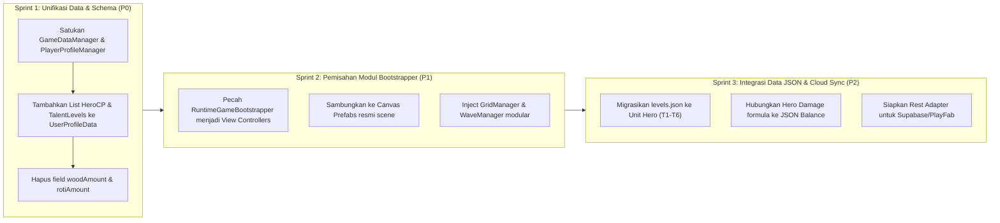

# MASTER GAME DESIGN & TECHNICAL SYSTEM SPECIFICATION
## Rampartbound: Pixel Defense — Production Architecture & Data Flow Reference
**Role:** Business & System Analyst (BA/SA)  
**Target Audience:** Project Manager (PM), Engineering Division, QA Divison  
**Status:** Official Technical Specification (SSOT — Single Source of Truth)  
**Version:** v2.15.0 (Resmi Disahkan: Standarisasi Arsitektur Unity Modular Assets/_Project/, Kontrak Interface C#, & Tata Kelola Multi-Agen Orca+Antigravity)  
**Engine:** Unity 6 (`6000.6.4f1`) | **Pipeline:** Universal 2D (URP) | **Platform:** Mobile (Android & iOS)

---

## DAFTAR ISI
1. [Visi Teknis & Arsitektur Sistem Runtime](#1-visi-teknis--arsitektur-sistem-runtime)
   - 1.1 Analisis Kondisi Arsitektur Saat Ini: Monolithic vs Modular
   - 1.2 Target Arsitektur Produksi: Clean Layered Architecture
   - 1.3 Pola Desain (Design Patterns) & Standar Komunikasi
   - 1.4 Standar Struktur Folder Produksi Unity (`Assets/_Project/`) & Modularitas
   - 1.5 Struktur Scripts Berbasis Fitur (Feature-Driven SRP) & Kontrak Antarmodul C#
   - 1.6 Tata Kelola Multi-Agen Orca + Antigravity & Konfigurasi Git Worktree
2. [End-to-End System & Data Flow](#2-end-to-end-system--data-flow)
   - 2.1 State Machine Siklus Hidup Game
   - 2.2 Sequence Diagram: Boot hingga Database Sync
   - 2.3 Rincian Alur Per Fase (Boot -> Title -> Lobby -> Level Select -> Battle Loop -> Post-Battle -> Sync)
   - 2.4 Perbandingan Mekanisme Tempur: Level 1 (Pair Merge-2) vs Level 2 (SupaMerge Match-3+)
3. [Arsitektur Database & Integritas Data](#3-arsitektur-database--integritas-data)
   - 3.1 Detail Skema Data Pemain (`UserProfileData.json`)
   - 3.2 Mekanisme Transaksi File Atomik (`.tmp` Swap Pattern)
   - 3.3 Sistem Kriptografi HMAC-SHA256 & Obfuscation Anti-Cheat
   - 3.4 Cetak Biru Migrasi ke Cloud Database Publik (Supabase & PlayFab)
4. [Analisis Kesenjangan Teknis (Technical Gap Analysis) & Roadmap Solusi](#4-analisis-kesenjangan-teknis-technical-gap-analysis--roadmap-solusi)
   - 4.1 Temuan Gap Kritis (UI, Data, Gameplay)
   - 4.2 Matriks Dampak & Risiko
   - 4.3 Action Plan & Roadmap Rekonsiliasi Bertahap

---

## 1. VISI TEKNIS & ARSITEKTUR SISTEM RUNTIME

### 1.1 Analisis Kondisi Arsitektur Saat Ini: Monolithic vs Modular
Di dalam repository `Rampartbound` saat ini, terdapat dua paradigma arsitektur yang saling bertolak belakang (*architectural duality*):

```
                        ┌────────────────────────────────────────────────────────┐
                        │              KONDISI SAAT INI (DUAL PARADIGM)           │
                        └────────────────────────────────────────────────────────┘
                                                    │
                 ┌──────────────────────────────────┴──────────────────────────────────┐
                 ▼                                                                     ▼
┌──────────────────────────────────────────────┐     ┌─────────────────────────────────────────────────┐
│     PARADIGMA 1: PROTOTYPE BOOTSTRAPPER      │     │         PARADIGMA 2: MODULAR COMPONENTS         │
│         (RuntimeGameBootstrapper.cs)         │     │         (Assets/Scripts/{Core, Defense,...})    │
├──────────────────────────────────────────────┤     ├─────────────────────────────────────────────────┤
│ • Monolitik procedural (~2.556 baris C#)     │     │ • Modular terpencar ke dalam banyak MonoBehaviour│
│ • [RuntimeInitializeOnLoadMethod] auto-spawn │     │ • Desain berorientasi Scene Hierarchy / Prefab  │
│ • Menghapus Canvas Scene yang ada secara paksa│    │ • Menggunakan ScriptableObject / JSON Resources │
│ • Logika UI, Data, Grid & Combat menyatu     │     │ • Memiliki sistem terpisah (PlayerProfileMgr dll)│
└──────────────────────────────────────────────┘     └─────────────────────────────────────────────────┘
```

1. **Paradigma 1: `RuntimeGameBootstrapper.cs` (Monolitik)**
   - Menggunakan atribut `[RuntimeInitializeOnLoadMethod(RuntimeInitializeLoadType.AfterSceneLoad)]`.
   - Menginisialisasi seluruh GameObject, UI Canvas, tekstur prosedural rumput, audio event, 6x6 grid data, spawner monster, avatar Rose, dan coroutine combat dari kode murni tanpa bergantung pada scene serialization.
   - **Kelebihan:** Sangat cepat untuk testing prototipe instan; mencegah missing prefab link di Unity Editor.
   - **Kelemahan:** Mengabaikan *Single Responsibility Principle (SRP)*, sulit di-unit test, berisiko merge conflict berat antar-programmer, dan mengabaikan prefab modular yang telah disiapkan di scene.

2. **Paradigma 2: `Assets/Scripts/` Modular Architecture**
   - Terbagi rapi ke dalam domain:
     - `Defense/`: `WaveManager.cs`, `EnemyMonster.cs`, `HeroUnit.cs`, `RampartBase.cs`, `Projectile.cs`, `BattleCardManager.cs`.
     - `Core/`: `GridManager.cs`, `TileSlot.cs`, `MergeItem.cs`, `LevelManager.cs`, `SaveDataManager.cs`.
     - `Meta/`: `PlayerProfileManager.cs`, `CampTalentsManager.cs`, `LobbyUIManager.cs`.
     - `Data/`: `GameDataManager.cs`, `ItemData.cs`, `LevelData.cs`.
   - **Kelebihan:** Sangat modular, siap dipasangkan pada prefab grafis, decoupled, dan mudah di-maintain.
   - **Kelemahan:** Belum terikat 100% dengan `RuntimeGameBootstrapper` karena bootstrapper mematikan Canvas scene (`CleanupDuplicateSceneCanvases()`).

### 1.2 Target Arsitektur Produksi: Clean Layered Architecture
Untuk rilis komersial, arsitektur harus dimigrasikan ke pola **Clean Layered Architecture (DDD - Domain Driven Design)** yang terbagi ke dalam 4 layer utama:

```
┌─────────────────────────────────────────────────────────────────────────────┐
│ 1. PRESENTATION / UI LAYER                                                  │
│    • TitleScreenController      • LobbyHUDView          • BattleHUDView     │
│    • LevelSelectModalView       • PerkSelectionModal    • VictoryDefeatModal│
│    • TouchCursorOverlay         • SafeAreaFitter        • FloatingDamageView│
└──────────────────────────────────────┬──────────────────────────────────────┘
                                       │ Event Binding / Command Dispatch
┌──────────────────────────────────────▼──────────────────────────────────────┐
│ 2. APPLICATION / CONTROLLER LAYER                                           │
│    • AppBootstrapper (Service Locator / DI Root Container)                  │
│    • GameFlowController (FSM: Boot -> Title -> Lobby -> Battle -> PostBattle)│
│    • BattleSessionController (Turns, Waves, Energy Gating)                  │
└──────────────────────────────────────┬──────────────────────────────────────┘
                                       │ Invokes Business Rules
┌──────────────────────────────────────▼──────────────────────────────────────┐
│ 3. CORE DOMAIN & GAMEPLAY LOGIC LAYER                                       │
│    ┌───────────────────────────┐         ┌───────────────────────────────┐  │
│    │     GRID MERGE DOMAIN     │         │     TOWER DEFENSE DOMAIN      │  │
│    │ • GridBoard (6x6 Model)   │         │ • RampartDefense (Wall Model) │  │
│    │ • IMergeStrategy:         │         │ • WaveSpawner & Timeline      │  │
│    │   - PairMergeStrategy     │         │ • HeroCombatUnit & Turrets    │  │
│    │   - SupaMergeMatch3       │         │ • MonsterPathing & Health     │  │
│    │ • CascadeEngine           │         │ • RoguelikePerkRegistry       │  │
│    └───────────────────────────┘         └───────────────────────────────┘  │
└──────────────────────────────────────┬──────────────────────────────────────┘
                                       │ Updates / Reads State
┌──────────────────────────────────────▼──────────────────────────────────────┐
│ 4. DATA & INFRASTRUCTURE LAYER                                              │
│    • Unified GameDataManager (SSOT In-Memory State)                         │
│    • LocalPersistence: Atomic File Handler (.tmp swap) + Checksum Verifier  │
│    • CloudSync: Supabase / PlayFab REST Client + Offline Conflict Resolver  │
│    • Audio / VFX Service Adapters                                           │
└─────────────────────────────────────────────────────────────────────────────┘
```

### 1.3 Pola Desain (Design Patterns) & Standar Komunikasi
1. **Service Locator / Inversion of Control (IoC):**
   - Bootstrapper bertindak sebagai composition root tunggal yang meregistrasikan service inti (`IDataService`, `IAudioService`, `IGameplayFlow`, `IStorageService`).
2. **Strategy Pattern untuk Mekanisme Merge:**
   - Antarmuka `IMergeStrategy` dengan implementasi `PairMergeStrategy` (Level 1) dan `SupaMergeMatch3Strategy` (Level 2). Memungkinkan penukaran aturan main secara runtime tanpa merusak class `GridManager`.
3. **Event-Driven Observer Pattern:**
   - Seluruh perubahan data menggunakan C# Action/Delegates (`OnEnergyUpdated`, `OnDataUpdated`, `OnWaveCleared`, `OnMonsterDied`, `OnBaseDamaged`). View hanya mendengar event dan mengupdate visual secara reaktif, tanpa ada pemanggilan langsung dari domain ke UI.
4. **Object Pooling Pattern:**
   - Untuk proyektil panah/meriam, monster slime/demon, floating damage text, dan partikel merge. Mencegah alokasi memori berlebih (`GC Alloc`) guna menjamin kestabilan 60 FPS di perangkat low-end.

### 1.4 Standar Struktur Folder Produksi Unity (`Assets/_Project/`) & Modularitas
Sesuai arahan arsitektur industri Unity dan referensi integrasi sub-agent multi-AI:
Seluruh aset, skrip, dan scene in-house tim studio **WAJIB** berada di dalam subfolder `Assets/_Project/` (dengan tanda underscore agar selalu berada di urutan teratas hierarki Unity Project Window) guna memisahkan aset in-house dari third-party plugins, packages, dan dependensi eksternal.

```text
MyGame/
├── Assets/
│   ├── _Project/            # Seluruh file in-house yang dikembangkan tim studio
│   │   ├── Scripts/         # Subdivisi skrip modular feature-driven (Core, Defense, UI, dll.)
│   │   ├── Art/             # Sprites, Textures, Backgrounds, Badges
│   │   ├── Audio/           # BGM (Lobby, Celtic Battle) & SFX Combat WAV HD
│   │   ├── Animations/      # Animator controllers & clip evolusi
│   │   ├── Materials/       # URP 2D Unlit & Sprite Default materials
│   │   ├── Prefabs/         # Player tokens, monsters, palisade, UI modal
│   │   ├── Scenes/          # Bootstrap, MainMenu, BattleStage, TestArena
│   │   ├── Data/            # ScriptableObjects & JSON config (sample_cards, sample_waves)
│   │   ├── UI/              # UI prefabs, fonts, icons
│   │   └── Settings/        # URP 2D Render Pipeline Assets
│   └── Plugins/             # Plugin eksternal (TextProgressBar, Haptic mobile dll.)
├── Packages/                # Dependensi Unity Package Manager (manifest.json)
├── ProjectSettings/         # Konfigurasi editor, input, graphic quality, platform build
└── .gitignore               # Pengecualian wajib: Library/, Temp/, Obj/, *.csproj, Logs/
```

### 1.5 Struktur Scripts Berbasis Fitur (Feature-Driven SRP) & Kontrak Antarmodul C#
Untuk mencegah penumpukan ribuan baris kode dalam satu file raksasa (*God Object Anti-Pattern*), pembagian skrip wajib menerapkan prinsip *Single Responsibility Principle (SRP)*:

```text
Assets/_Project/Scripts/
├── Core/             # Inisialisasi: GameBootstrap.cs, GameManager.cs, GameState.cs, SceneLoader.cs
├── Grid/             # GridManager.cs, TileSlot.cs, MergeItem.cs, CascadeEngine.cs
├── Defense/          # HeroUnit.cs, Projectile.cs, BastionCannon.cs, PalisadeWall.cs
├── Enemies/          # EnemyController.cs, EnemyMonster.cs, EnemySpawner.cs, WaveManager.cs
├── Cards/            # BattleCardManager.cs, RoguelikePerkRegistry.cs
├── UI/               # MainMenuUI.cs, LobbyUIController.cs, BattleHUDController.cs, CardSelectionModal.cs
├── Audio/            # AudioManager.cs (BGM/SFX Sound Routing & Volume Ducking)
├── SaveSystem/       # SaveDataManager.cs (Atomic .tmp swap + HMAC-SHA256)
├── Meta/             # CampTalentsManager.cs, PlayerProfileManager.cs
└── Shared/
    ├── Interfaces/   # IDamageable.cs, IShooter.cs, IMergeable.cs, ICardBlessingEffect.cs
    ├── Events/       # GameEventBus.cs, CombatEvents.cs
    └── Utilities/    # MathUtility.cs, SafeWaitCoroutine.cs
```

#### Kontrak Antarmodul via C# Interfaces (`Shared/Interfaces/`)
Sub-agent yang bekerja paralel di Orca/Antigravity berkomunikasi melalui antarmuka (*interfaces*), bukan coupling langsung:
1. `IDamageable`: Entitas monster dan benteng mengimplementasikan method `TakeDamage(float amount)` dan properti `CurrentHealth`, `MaxHealth`, `IsDead`. Unit pahlawan/meriam hanya memanggil `target.TakeDamage()` tanpa perlu tahu detail internal monster.
2. `IShooter`: Unit pahlawan dan turret mengimplementasikan `AttackRange`, `AttackCooldown`, `BaseDamage`, serta method `ShootAt(IDamageable target)`.
3. `IMergeable`: Item token puzzle mengimplementasikan `Tier`, `ItemIdentifier`, `CanMergeWith(IMergeable other)`, dan `EvolveTier()`.
4. `ICardBlessingEffect`: Kartu roguelike mengimplementasikan `CardId`, `Rarity`, dan `ApplyEffect()`.

### 1.6 Tata Kelola Multi-Agen Orca + Antigravity & Konfigurasi Git Worktree
1. **Model Kepemilikan Modul & File (File Domain Ownership):**
   - Main Agent / PM: Arsitektur umum, integrasi, kontrak interface, dan eksekusi Git Push remote.
   - Sub-Agent Player/Grid: Berfokus pada `Grid/` dan `Meta/`.
   - Sub-Agent Combat & Defense: Berfokus pada `Defense/` dan `Projectiles`.
   - Sub-Agent Enemies & Balance: Berfokus pada `Enemies/` dan `GameDesign/Balance/`.
   - Sub-Agent UI & Art: Berfokus pada `UI/`, prefabs modal, dan sprites.
   - Integrator & QA Gatekeeper: Audit fungsional, pengujian Console Unity tanpa error, dan sertifikasi Dual QA 100% PASS.
2. **Isolasi Git Worktree di Orca:**
   - Menggunakan satu repository dengan multiple worktrees terpisah (`worktree-player`, `worktree-combat`, `worktree-enemy`, `worktree-ui`) saat agen bekerja secara simultan agar mencegah file locking pada asset Unity/meta.
3. **Standar Pengaturan Editor Unity untuk Version Control:**
   - **Version Control Mode:** `Visible Meta Files` (wajib).
   - **Asset Serialization Mode:** `Force Text` (wajib, agar prefab dan scene berbentuk YAML teks terbaca yang ramah Git).
   - Seluruh file `.meta` wajib di-commit bersama asetnya agar GUID referensi komponen tidak rusak.
4. **Urutan Pengembangan Paling Aman (Phase Ordering):**
   - Tahap 1: Setup Project & Repository (Folder `_Project/` & `.gitignore`).
   - Tahap 2: Core Bootstrap & Kontrak Interface (`Shared/Interfaces/`).
   - Tahap 3: Vertical Slice Playable (Game loop Wave 1–5 teruji dapat dimainkan).
   - Tahap 4: Parallel Development (Ekspansi fitur via sub-agent di worktree terpisah).
   - Tahap 5: Integration & Dual QA Gatekeeping (Merge bertahap & verifikasi bebas error).

---

## 2. END-TO-END SYSTEM & DATA FLOW

### 2.1 State Machine Siklus Hidup Game
```
[ Game Launch / Cold Boot ]
            │
            ▼
┌─────────────────────────┐     Validasi File JSON & Regen Energi
│      STATE: BOOT        │ ────────────────────────────────────────┐
└─────────────────────────┘                                         │
            │                                                       │
            ▼                                                       ▼
┌─────────────────────────┐                             ┌───────────────────────┐
│      STATE: TITLE       │                             │  GameDataManager      │
│  (Tap to Start Hotspot) │                             │  Load & Verify HMAC   │
└─────────────────────────┘                             └───────────────────────┘
            │ User Tap                                              ▲
            ▼                                                       │
┌─────────────────────────┐                                         │
│      STATE: LOBBY       │ ◄─── (Resource HUD: 30/30 Energy, Gold) │
│ (Castle, Hero, Bag, Hub)│                                         │
└─────────────────────────┘                                         │
            │ Klik Tombol Battle                                    │
            ▼                                                       │
┌─────────────────────────┐                                         │
│   STATE: LEVEL SELECT   │                                         │
│ (Level 1 vs Level 2)    │                                         │
└─────────────────────────┘                                         │
            │ Validasi & Konsumsi Energi (-5 ⚡)                     │
            ├───────────────────────────────────────────────────────┤
            ▼                                                       ▼
┌─────────────────────────┐                             ┌───────────────────────┐
│     STATE: BATTLE       │                             │ GameDataManager       │
│ ┌─────────────────────┐ │                             │ ConsumeEnergy(5)      │
│ │ LEVEL 1: PAIR MERGE │ │                             │ Atomic File Save      │
│ └─────────────────────┘ │                             └───────────────────────┘
│ ┌─────────────────────┐ │                                         ▲
│ │ LEVEL 2: SUPAMERGE  │ │                                         │
│ └─────────────────────┘ │                                         │
└─────────────────────────┘                                         │
            │ Win / Lose Condition Trigger                          │
            ▼                                                       │
┌─────────────────────────┐                                         │
│   STATE: POST-BATTLE    │                                         │
│ (Victory/Defeat Modals) │                                         │
└─────────────────────────┘                                         │
            │ Sinkronisasi Hadiah & Progres                         │
            └───────────────────────────────────────────────────────┘
```

### 2.2 Sequence Diagram: Boot hingga Database Sync
```mermaid
sequenceDiagram
    autonumber
    actor Player as Pemain (Touch Input)
    participant Boot as App Bootstrapper
    participant UI as UI Navigation Manager
    participant Grid as Grid Merge Controller
    participant TD as Wave & Defense Engine
    participant Data as GameDataManager (SSOT)
    participant Disk as Local File (.tmp Swap)
    participant Cloud as Cloud DB (Supabase/PlayFab)

    Note over Boot,Data: 1. FASE BOOT & INISIALISASI
    Boot->>Data: Initialize & LoadData()
    Data->>Disk: Baca UserProfileData.json
    Disk-->>Data: Raw JSON Payload
    Data->>Data: Validate HMAC-SHA256 Checksum
    Data->>Data: Hitung Offline Energy Regen (+1 tiap 8 mnt)
    Data-->>Boot: Data Siap (Energy, Gold, UnlockedLevels)
    Boot->>UI: Buka Title Screen ("Tap To Start")

    Note over Player,UI: 2. TITLE SCREEN -> LOBBY HUB
    Player->>UI: Tap Layar Title Screen
    UI->>UI: Fade Transition (0.35s)
    UI->>Data: Ambil Saldo Energi & Gold
    Data-->>UI: Energy: 30/30, Gold: 500 G
    UI->>UI: Tampilkan Main Lobby Hub

    Note over Player,Data: 3. LEVEL SELECT & ENERGY GATING
    Player->>UI: Tap Tombol Battle -> Buka Modal Level
    Player->>UI: Pilih Level 1 / Level 2
    UI->>Data: ConsumeEnergyForBattle(5)
    alt Energi Kurang (< 5)
        Data-->>UI: False (Reject)
        UI->>Player: Munculkan Floating Toast "Energi Tidak Cukup"
    else Energi Cukup (>= 5)
        Data->>Data: currentEnergy -= 5
        Data->>Disk: Atomic Save (Write .tmp -> Replace .json)
        Data-->>UI: True (Permitted)
        UI->>UI: SwitchScreen("Battle")
    end

    Note over Grid,TD: 4. BATTLE CORE LOOP
    alt Level 1 (Pair Merge-2 Arcade)
        Grid->>Grid: Spawn 6 Hero Awal di Petak 6x6
        TD->>TD: Jalankan Real-time Spawner (Wave 1-3)
        loop Combat Cycle
            Player->>Grid: Tap/Drag 2 Hero Identik (T1 + T1)
            Grid-->>Grid: Evolve Hero ke Tier 2 (Arthur)
            Player->>Grid: Tap Arcane Cube (Biaya 50G)
            Grid-->>Grid: Spawn Random Hero Baru
            TD->>TD: Turrets, Rose & Hero Tembak Monster Terdepan
        end
    else Level 2 (SupaMerge Match-3+ Turn-Based)
        Grid->>Grid: Isi Penuh Seluruh 36 Petak
        Note over Grid: Fase Taktis (5 Langkah Merge)
        loop Turn-based Phase (Moves > 0)
            Player->>Grid: Tukar Petak Berdampingan (Swap)
            Grid->>Grid: BFS Cek Sambungan >= 3 Hero Kembar
            Grid-->>Grid: Collapse ke Tier+1 & Cascade Gravity Refill
            Grid->>Grid: Moves Remaining--
        end
        Note over TD: Fase Serbuan (Combat Wave)
        TD->>TD: Monster Turun Serentak; Hero Menembak Otomatis
        TD-->>Grid: Wave Clear -> Reset 5 Langkah Baru!
    end

    Note over TD,Cloud: 5. POST-BATTLE REWARD & DATABASE SYNC
    TD->>TD: Kondisi Menang Tercapai (3 Wave Clear)
    TD->>UI: Tampilkan Victory Modal (+Gold, +EXP, +Bintang)
    UI->>Data: RecordLevelVictory(level, stars, score, rewardGold)
    Data->>Data: Tambah Gold, Buka Level Berikutnya
    Data->>Data: Hitung Ulang HMAC-SHA256 Checksum
    Data->>Disk: Atomic File Write (.tmp -> UserProfileData.json)
    Data->>Disk: Backup Obfuscated PlayerPrefs
    opt Koneksi Internet Tersedia
        Data->>Cloud: Async Sync Payload (REST API / RPC)
        Cloud-->>Data: HTTP 200 OK (Sync Acknowledged)
    end
    UI->>Player: Navigasi Kembali ke Lobby Hub (Update Resource)
```

### 2.3 Rincian Alur Per Fase

#### Fase 1: Game Boot & Early Startup
1. Unity menjalankan `RuntimeInitializeLoadType.BeforeSceneLoad` pada `GameDataManager`.
2. `GameDataManager.LoadData()` memeriksa eksistensi `UserProfileData.json` di `Application.persistentDataPath`.
3. Membaca teks JSON dan memverifikasi integritas hash HMAC-SHA256 dengan secret salt studio. Jika valid, data di-parse ke instance `profile`. Jika rusak, beralih ke secure backup PlayerPrefs.
4. Menghitung regenerasi energi offline: Menghitung selisih waktu `DateTime.UtcNow - lastEnergyRegenTimeUtc`. Setiap kelipatan 8 menit menambahkan 1 poin energi hingga batas `maxEnergy` (30).
5. Kamera Orthographic (Size 6.0) dan Canvas Scaler (1080x1920) dikonfigurasi. Skrip menghitung rasio layar: jika aspect ratio > 0.62 (tablet iPad), `matchWidthOrHeight = 0.85f`; jika ponsel (16:9 atau 20:9), `matchWidthOrHeight = 0.15f` guna mencegah penumpukan elemen UI.

#### Fase 2: Title Screen (Layar Pembuka)
1. Menampilkan artwork 16-bit retro beresolusi tinggi `TitleScreen.jpg`.
2. Komponen transparan tanpa gambar ditempatkan presisi di atas tombol emas "TAP TO START" pada ilustrasi asli.
3. Kursor tangan interaktif (`Interactive_Hand_Cursor`) mengikuti koordinat sentuhan jari atau klik mouse secara real-time.
4. Input sentuhan memicu `AudioManager.PlayTapSound()` dan animasi *Fade to Black* selama 0.35 detik sebelum mengaktifkan layar Lobby.

#### Fase 3: Main Lobby Hub & Manajemen Sumber Daya
1. **Aturan Baku Sumber Daya:** Hanya menampilkan **Energi (⚡)** dan **Koin Emas (🪙)**. Seluruh referensi Roti (*Bread*) dan Kayu (*Wood*) dihapus total.
2. Hotspot interaktif pada pahlawan (Lena, Arthur, Eldon) memungkinkan inspeksi Combat Power (CP) dan upgrade status langsung di desa.
3. Navigasi bawah menghubungkan ke modal:
   - **Castle Modal:** Status garrison dan buff pasif benteng (+15% HP benteng).
   - **Heroes Modal:** Rincian party, Combat Power, bintang, dan skill aktif pahlawan.
   - **Bag Modal:** Inventaris perlengkapan (Arcane Summon Core, Fortification Stone).
   - **Settings Modal:** Konfigurasi audio, toggle 60 FPS, dan status enkripsi anti-cheat.
4. Tombol tengah "BATTLE" membuka dialog pemilihan level.

#### Fase 4: Level Select & Energy Gating
1. Modal menyajikan 2 misi utama:
   - **Level 1: Pos Terdepan (Outpost Defense)** — Mode Pair Merge-2 Arcade.
   - **Level 2: Pengepungan Benteng (Fortress Siege)** — Mode SupaMerge Kembar-3+.
2. Setiap pemilihan misi memeriksa syarat tiket masuk: `currentEnergy >= 5`.
3. Jika saldo energi < 5, game memunculkan floating warning: `"⚡ ENERGI TIDAK CUKUP! BUTUH MINIMAL 5 ENERGI"`.
4. Jika saldo cukup, game langsung memotong 5 energi, memperbarui timestamp simpan, mengeksekusi *atomic write* ke disk, lalu meluncurkan pertempuran.

#### Fase 5: Battle Core Loop
Perbedaan mendalam mekanisme Level 1 vs Level 2 diuraikan pada [Sub-bab 2.4](#24-perbandingan-mekanisme-tempur-level-1-pair-merge-2-vs-level-2-supamerge-match-3).

#### Fase 6: Post-Battle Rewards & Win/Lose Logic
1. **Kondisi Menang (Victory):**
   - Terjadi bila Wave ke-3 berhasil diselesaikan dan `rampartHP > 0`.
   - Menghentikan seluruh combat coroutine.
   - Menghitung hadiah:
     - Level 1: +500 Gold, 3 Bintang, High Score diperbarui.
     - Level 2: +800 Gold, Membuka stage ekspansi berikutnya.
   - Memanggil `GameDataManager.Instance.RecordLevelVictory()`.
   - Menampilkan `Modal_Victory` dengan tombol kembali ke lobby.
2. **Kondisi Kalah (Defeat):**
   - Terjadi saat `rampartHP <= 0` akibat monster menabrak palisade tembok benteng.
   - Layar bergetar (*Screen Shake* 0.25s) dan palisade menampilkan sprite `rampart_wall_critical.png`.
   - `AudioManager.PlayGameOver()` dijalankan.
   - Menampilkan `Modal_Defeat` dengan opsi *Coba Lagi* (memotong 5 energi baru) atau *Kembali ke Lobby*.

#### Fase 7: Database Sync & Commit
1. Menggabungkan emas yang diperoleh dari sesi pertempuran ke dalam saldo akun pemain.
2. Mencatat waktu simpan UTC terkini.
3. Menghitung ulang nilai checksum HMAC-SHA256 berdasarkan seluruh properti akun.
4. Menuliskan file data secara atomik ke disk lokal dan memperbarui cadangan PlayerPrefs.
5. Menyiapkan paket data untuk sinkronisasi latar belakang ke cloud database jika koneksi internet terdeteksi.

---

### 2.4 Perbandingan Mekanisme Tempur: Level 1 vs Level 2

| Parameter Analisis | Level 1: Outpost Defense (Pair Merge-2) | Level 2: Fortress Siege (SupaMerge Match-3+) |
|---|---|---|
| **Filosofi Gameplay** | Reaktif, Cepat, Real-Time Arcade Merge | Taktis, Penuh Perhitungan, Turn-Based Puzzle Defense |
| **Kondisi Grid Awal** | Papan 6x6 sebagian besar kosong; 6 pahlawan di-spawn acak | Seluruh 36 petak ubin papan terisi penuh oleh pahlawan T1 & T2 |
| **Aturan Evolusi (Merge)** | **Pair Merge (Kembar-2):** Gabungkan 2 pahlawan bertier sama di mana saja | **SupaMerge (Kembar-3+):** Tukar 2 petak bersebelahan; memicu runtuhan jika $\ge 3$ sama |
| **Mekanika Pemanggilan** | **Arcane Summon Cube:** Klik tombol kubus 3D di bawah papan (Biaya 50 Gold) | **Cascade Refill:** Gravitasi otomatis menjatuhkan pahlawan atas, baris atas terisi hero baru |
| **Alur Fase (Turn / Pacing)** | **Fase Kontinu Real-Time:** Monster terus berjalan turun sambil pemain melakukan merge | **Dual Phase Loop:**<br>1. *Phase Merge:* 5 langkah taktis (monster diam)<br>2. *Phase Combat:* Monster turun serentak |
| **Kondisi Kebuntuan (Stalemate)**| Pemain bebas memanggil hero baru selama memiliki emas cadangan | **Auto-Reshuffle:** Algoritma mendeteksi ketiadaan kombinasi 3-kembar & mengacak papan |
| **Roguelike Perks** | Pemilihan 1 dari 3 kartu berkah di akhir setiap wave (Swift Relic, Heavy Mortar, Fortify) | Pengisian ulang 5 langkah taktis baru setiap kali gelombang monster berhasil ditumpas |

---

## 3. ARSITEKTUR DATABASE & INTEGRITAS DATA

### 3.1 Detail Skema Data Pemain (`UserProfileData.json`)

Berikut adalah spesifikasi struktur data persistensi JSON resmi pemain di `Application.persistentDataPath/UserProfileData.json`:

```json
{
  "playerId": "c4b1e840-79fa-4f28-9d62-d922bc954fa1",
  "playerName": "Commander Rose",
  "accountLevel": 1,
  "accountExp": 0,
  "currentEnergy": 30,
  "maxEnergy": 30,
  "gold": 500,
  "gems": 50,
  "highestUnlockedLevel": 1,
  "level1Completed": false,
  "level1Stars": 0,
  "level1HighScore": 0,
  "level2Completed": false,
  "level2Stars": 0,
  "level2HighScore": 0,
  "roseWeaponTier": 1,
  "fortHpLevel": 1,
  "cannonPowerLevel": 1,
  "lastEnergyRegenTimeUtc": "2026-10-07T10:15:30.0000000Z",
  "lastSaveTimestampUtc": "2026-10-07T10:15:30.0000000Z",
  "checksum": "8f3a9e2d5b6c7a1e0f4d8b9c2a3e4f5a6b7c8d9e0f1a2b3c4d5e6f7a8b9c0d1e"
}
```

#### Kamus Data (Data Dictionary)

| Nama Field | Tipe Data | Nilai Default | Batasan & Validasi | Deskripsi Bisnis & Logika Sistem |
|---|---|---|---|---|
| `playerId` | `string` (UUID v4) | Auto-generated GUID | Unik, non-empty, read-only | Pengenal identitas unik pemain across platform. |
| `playerName` | `string` | `"Commander Rose"` | 1–24 karakter UTF-8 | Nama display komandan benteng. |
| `accountLevel` | `int` | `1` | Min: 1, Max: 50 | Level akun pemain. Meningkat via exp tempur. |
| `accountExp` | `int` | `0` | Min: 0, Max: ExpThreshold | Akumulasi pengalaman akun saat ini. |
| `currentEnergy` | `int` | `30` | Min: 0, Max: `maxEnergy` | Tiket energi aktif. Berkurang 5 tiap battle. |
| `maxEnergy` | `int` | `30` | Min: 30, Max: 60 | Kapasitas maksimum energi pemain. |
| `gold` | `int` | `500` | Min: 0, Max: 2.147.483.647 | Koin emas kerajaan untuk upgrade talenta & hero. |
| `gems` | `int` | `50` | Min: 0, Max: 999.999 | Mata uang premium untuk reset / gacha masa depan. |
| `highestUnlockedLevel` | `int` | `1` | Nilai: 1 s/d MaxLevel | Penentu akses batas level misi yang dapat dimainkan. |
| `level1Completed` | `bool` | `false` | `true` jika Stage 1 tamat | Flag penyelesaian misi Outpost Defense. |
| `level1Stars` | `int` | `0` | Nilai: 0, 1, 2, atau 3 | Perolehan bintang tertinggi di Level 1. |
| `level1HighScore` | `int` | `0` | Min: 0 | Skor pertempuran tertinggi di Level 1. |
| `level2Completed` | `bool` | `false` | `true` jika Stage 2 tamat | Flag penyelesaian misi Fortress Siege. |
| `level2Stars` | `int` | `0` | Nilai: 0, 1, 2, atau 3 | Perolehan bintang tertinggi di Level 2. |
| `level2HighScore` | `int` | `0` | Min: 0 | Skor pertempuran tertinggi di Level 2. |
| `roseWeaponTier` | `int` | `1` | Nilai: 1, 2, atau 3 | Evolusi senjata tempa Commander Rose. |
| `fortHpLevel` | `int` | `1` | Min: 1, Max: 20 | Level upgrade ketebalan dinding benteng. |
| `cannonPowerLevel` | `int` | `1` | Min: 1, Max: 20 | Level daya rusak meriam pertahanan benteng. |
| `lastEnergyRegenTimeUtc`| `string` (ISO-8601)| UtcNow timestamp | Format UTC `"o"` | Patokan waktu pemulihan regenerasi energi (8 mnt/pt). |
| `lastSaveTimestampUtc` | `string` (ISO-8601)| UtcNow timestamp | Format UTC `"o"` | Timestamp penyimpanan data terakhir untuk resolving cloud. |
| `checksum` | `string` | `""` | 64 karakter Hexadecimal | Tanda tangan digital HMAC-SHA256 anti-manipulasi data. |

---

### 3.2 Mekanisme Transaksi File Atomik (`.tmp` Swap Pattern)

#### Masalah Fatal Penulisan Konvensional:
Pada perangkat mobile, jika game melakukan `File.WriteAllText("save.json")` langsung ke file target saat baterai ponsel tiba-tiba habis, OS mematikan proses di background (*OOM kill*), atau terjadi crash, file save akan terpotong setengah (*partial write / 0-byte file*). Akibatnya, seluruh progres pemain rusak permanen.

#### Solusi Standar Industri Rampartbound:
Menggunakan **3-Step Atomic File Swap Pattern**:

```
[ In-Memory UserProfileData ]
              │
              ▼ 1. Serialize & Hitung HMAC
┌───────────────────────────────┐
│     UserProfileData.json.tmp  │ ◄── Tulis ke File Sementara (.tmp)
└───────────────────────────────┘
              │
              ▼ 2. Verifikasi File .tmp Sukses Tertulis
       [ File.Exists && Size > 0 ]
              │
              ├─ Valid ──────────────────────────────────┐
              │                                          ▼
              │                        ┌───────────────────────────────────┐
              │                        │ 3. Atomic Swap File               │
              │                        │    Hapus save lama (jika ada)     │
              │                        │    Rename .tmp -> UserProfileData │
              │                        └───────────────────────────────────┘
              │                                          │
              ▼ Gagal                                    ▼ Sukses
┌───────────────────────────────┐      ┌───────────────────────────────────┐
│ Abort Swap & Gunakan Cadangan │      │ Save File Resmi Siap & Terlindungi│
│ PlayerPrefs Obfuscated Backup │      └───────────────────────────────────┘
└───────────────────────────────┘
```

#### Implementasi C# di GameDataManager:
```csharp
// Path File Utama & Sementara
string saveFilePath = Path.Combine(Application.persistentDataPath, "UserProfileData.json");
string tempFilePath = Path.Combine(Application.persistentDataPath, "UserProfileData.json.tmp");

// Langkah 1: Tulis data JSON utuh ke file .tmp terlebih dahulu
File.WriteAllText(tempFilePath, finalJson, Encoding.UTF8);

// Langkah 2 & 3: Atomic Swap aman
if (File.Exists(saveFilePath))
{
    File.Delete(saveFilePath);
}
File.Move(tempFilePath, saveFilePath);
```
Dengan skema ini, file save asli tidak akan pernah disentuh sebelum file sementara `.tmp` 100% selesai ditulis dan divalidasi.

---

### 3.3 Sistem Kriptografi HMAC-SHA256 & Obfuscation Anti-Cheat

Untuk mencegah manipulasi nilai uang (`gold`), energi (`currentEnergy`), maupun status level via aplikasi editor hex (seperti Cheat Engine, GameGuardian, atau edit teks manual di Android Rooted):

```
┌─────────────────────────────────────────────────────────────────────────────┐
│ PIPELINE KALKULASI CHECKSUM (SAAT MENYIMPAN)                                │
├─────────────────────────────────────────────────────────────────────────────┤
│ 1. Set property profile.checksum = ""                                       │
│ 2. Serialize profil ke string JSON baku (rawJson)                           │
│ 3. HMAC-SHA256: Input = UTF8.GetBytes(rawJson), Key = UTF8.GetBytes(SALT)   │
│ 4. Ubah byte hash menjadi 64 karakter Hexadecimal (computedHash)            │
│ 5. Set property profile.checksum = computedHash                             │
│ 6. Serialize kembali menjadi finalJson (yang kini memuat checksum resmi)    │
│ 7. Tulis ke file atomik & buat backup terenkripsi XOR-Base64 di PlayerPrefs │
└─────────────────────────────────────────────────────────────────────────────┘

┌─────────────────────────────────────────────────────────────────────────────┐
│ PIPELINE VALIDASI CHECKSUM (SAAT MEMUAT DATA)                               │
├─────────────────────────────────────────────────────────────────────────────┤
│ 1. Parse JSON dari disk ke objek temporaryData                              │
│ 2. Catat incomingChecksum = temporaryData.checksum                          │
│ 3. Set temporaryData.checksum = ""                                          │
│ 4. Serialize ulang menjadi rawJson                                          │
│ 5. Hitung expectedChecksum = ComputeHmac(rawJson, SALT)                     │
│ 6. Bandingkan: string.Equals(incomingChecksum, expectedChecksum)            │
│    ├── MATCH   ──> Integritas Asli Terjamin (Lanjutkan Muat Profil)         │
│    └── MISMATCH ─> Peringatan Curang / Corrupt (Gunakan Backup Aman / Reset)│
└─────────────────────────────────────────────────────────────────────────────┘
```

*Formula Garam Rahasia (Secret Salt Studio):*  
`HMAC_SALT = "Rampartbound_SecretSalt_2026_ProductionReady!";`

---

### 3.4 Cetak Biru Migrasi ke Cloud Database Publik (Supabase & PlayFab)

Untuk rilis publik multiplayer/cloud-save, arsitektur data lokal dirancang agar kompatibel dengan dua provider backend utama:

#### Opsi 1: Supabase (PostgreSQL + Row-Level Security + Edge Functions)
1. **Model Relasional Tabel PostgreSQL:**
   ```sql
   CREATE TABLE player_profiles (
       player_id UUID PRIMARY KEY,
       player_name VARCHAR(64) NOT NULL DEFAULT 'Commander Rose',
       account_level INT NOT NULL DEFAULT 1,
       account_exp INT NOT NULL DEFAULT 0,
       gold BIGINT NOT NULL DEFAULT 500,
       gems INT NOT NULL DEFAULT 50,
       current_energy INT NOT NULL DEFAULT 30,
       max_energy INT NOT NULL DEFAULT 30,
       highest_unlocked_level INT NOT NULL DEFAULT 1,
       last_energy_regen_time TIMESTAMPTZ NOT NULL DEFAULT NOW(),
       last_save_timestamp TIMESTAMPTZ NOT NULL DEFAULT NOW(),
       checksum VARCHAR(64) NOT NULL,
       updated_at TIMESTAMPTZ DEFAULT NOW()
   );

   CREATE TABLE stage_progress (
       id UUID PRIMARY KEY DEFAULT gen_random_uuid(),
       player_id UUID REFERENCES player_profiles(player_id) ON DELETE CASCADE,
       stage_id VARCHAR(16) NOT NULL,
       stars INT NOT NULL DEFAULT 0,
       high_score INT NOT NULL DEFAULT 0,
       is_completed BOOLEAN NOT NULL DEFAULT FALSE,
       UNIQUE(player_id, stage_id)
   );
   ```
2. **Keamanan Row-Level Security (RLS):**
   Pemain hanya diizinkan membaca dan memperbarui baris data yang memiliki `auth.uid() = player_id`.
3. **Server-Authoritative Energy Validation:**
   Pengurangan energi (-5) dan penambahan gold kemenangan dijalankan melalui **Supabase Edge Function** (`/rest/v1/rpc/claim_battle_reward`) untuk mencegah spoofing dari client.

#### Opsi 2: Microsoft PlayFab (Gaming Backend Standard)
1. **Player Title Data:** Menyimpan konfigurasi statis babak dan monster (`chapters_stages`, `talents_config`).
2. **Internal Virtual Currencies:**
   - `EN` (Energy): Menggunakan sistem otomatis regenerasi PlayFab Virtual Currency (1 unit per 480 detik, recharge max 30).
   - `GD` (Gold): Mata uang soft currency hasil battle.
   - `GM` (Gems): Mata uang hard currency premium.
3. **Player Read-Only Data:** Menyimpan status stage completion dan level hero guna mencegah pemain memodifikasi secara lokal.

#### Protokol Resolusi Konflik (Conflict Resolution Strategy)
Jika pemain bermain offline di kereta lalu tersambung kembali ke internet:
- **Timestamp Vector Check:** Membandingkan `lastSaveTimestampUtc` di lokal vs cloud.
- **Max-Progress Merge Algorithm:**
  $$\text{FinalUnlockedLevel} = \max(\text{LocalLevel}, \text{CloudLevel})$$
  $$\text{FinalStars} = \max(\text{LocalStars}, \text{CloudStars})$$
  $$\text{FinalGold} = \text{CloudGold} + \Delta \text{LocalEarnedGold}$$
Pendekatan ini menjamin bahwa progres bermain offline pemain tidak akan pernah hilang tertimpa data cloud lama.

---

## 4. ANALISIS KESENJANGAN TEKNIS (TECHNICAL GAP ANALYSIS) & ROADMAP SOLUSI

### 4.1 Temuan Gap Kritis (UI, Data, Gameplay)

Berdasarkan audit komparasi antara kode `RuntimeGameBootstrapper.cs`, modular scripts di `Assets/Scripts/`, dan file konfigurasi di `Assets/Resources/`, ditemukan 5 kesenjangan sistem yang memerlukan perhatian:

```
┌─────────────────────────────────────────────────────────────────────────────┐
│                     RINGKASAN 5 GAP TEKNIS UTAMA SAAT INI                   │
└─────────────────────────────────────────────────────────────────────────────┘
  [GAP 1: Dual-Data Fragmentasi]
  • RuntimeGameBootstrapper menggunakan GameDataManager (Rampartbound.Data)
  • Modular Scripts menggunakan PlayerProfileManager & SaveDataManager (MergeGame)
  • Gejala: Perubahan energi/gold di bootstrapper tidak terbaca di UI modular.

  [GAP 2: Monolitik Bootstrapper Me-Bypass Scene Canvas]
  • Bootstrapper mengeksekusi CleanupDuplicateSceneCanvases() dan build via C#.
  • Seluruh setup SceneSetupTool & UltimateHarmonySetup terhapus saat runtime play.

  [GAP 3: Hardcoded Stats vs Konfigurasi JSON Database]
  • Bootstrapper memiliki switch hardcoded damage hero (GetHeroDamage: 18, 36, 75).
  • File JSON levels.json masih memuat puzzle permata (Pebble, Jade) warisan lama.
  • File chapters_stages.json & sample_heroes.json diabaikan oleh bootstrapper.

  [GAP 4: Hero Combat Power (CP) Tidak Tersimpan ke Disk]
  • Tombol upgrade Lena, Arthur, Eldon di Lobby hanya menambah variabel in-memory (lenaCP += 1200).
  • Variabel CP ini tidak ada di UserProfileData.json, sehingga hilang saat restart game!

  [GAP 5: Sisa Resource Roti & Kayu di Skrip Talenta]
  • CampTalentsManager masih mendefinisikan: public int woodAmount = 8720; rotiAmount = 12450;
  • Bertentangan dengan aturan studio: Zero Bread & Wood Policy (Hanya Energi & Gold).
```

---

### 4.2 Matriks Dampak & Risiko

| No | Gap Teknis | Dampak Sistem | Tingkat Risiko | Area Terdampak |
|---|---|---|---|---|
| **1** | **Data Fragmentation (GameDataManager vs PlayerProfileManager)** | Desinkronisasi data antara modul tempur dan tampilan lobby HUD. | **CRITICAL (P0)** | Data Architecture |
| **2** | **Bypass Scene Canvas oleh Bootstrapper** | Desain visual artist di scene Unity tidak muncul; seluruh tampilan bergantung pada script procedural. | **HIGH (P1)** | UI / Art Integration |
| **3** | **Hardcoded Damage & Legacy Gem JSON** | Desainer level tidak bisa menyeimbangkan angka combat via file JSON di `Resources/`. | **HIGH (P1)** | Game Balancing |
| **4** | **Penyimpanan CP Hero Belum Ada di Skema JSON** | Pemain kehilangan progres upgrade pahlawan setelah keluar dari game (*Data Loss*). | **CRITICAL (P0)** | Persistence / Anti-Cheat |
| **5** | **Leftover Wood & Bread di CampTalentsManager** | Potensi kebingungan logika ekonomi; redundansi memori variabel yang tidak terpakai. | **MEDIUM (P2)** | Meta Progression |

---

### 4.3 Action Plan & Roadmap Rekonsiliasi Bertahap

Untuk menyelesaikan kesenjangan di atas secara rapi tanpa merusak stabilitas game yang sudah berjalan:



#### Spesifikasi Perubahan Teknis Sprint 1:
1. **Modifikasi `UserProfileData.cs`:**
   Tambahkan dictionary/list status pahlawan dan talenta agar tersimpan permanen secara atomik:
   ```csharp
   [Serializable]
   public class HeroProgressionEntry
   {
       public string heroId; // "lena", "arthur", "eldon", "rose"
       public int level = 1;
       public int combatPower = 1000;
       public int starRating = 1;
   }

   // Di dalam UserProfileData:
   public List<HeroProgressionEntry> heroes = new List<HeroProgressionEntry>();
   public List<int> unlockedTalentLevels = new List<int>();
   ```
2. **Pembersihan `CampTalentsManager.cs`:**
   Menghapus baris 57–58 (`woodAmount` dan `rotiAmount`) dan menghubungkan transaksi upgrade langsung ke `GameDataManager.Instance.SpendGold()`.
3. **Penyatuan Namespace:**
   Mengganti namespace lama `MergeGame.*` menjadi `Rampartbound.*` di seluruh file proyek dan membuat file `Rampartbound.asmdef` agar kompilasi script terisolasi dan cepat.

---

## 5. KESIMPULAN & REKOMENDASI BA/SA

Spesifikasi teknis ini menegaskan bahwa fondasi gameplay inti *Rampartbound: Pixel Defense* telah memiliki logika pertarungan yang kuat—baik pada mode **Level 1 (Pair Merge-2 Arcade)** maupun inovasi **Level 2 (SupaMerge Match-3+ Turn-Based)**. 

Dengan mengadopsi mekanisme **Atomic Write Swap (`.tmp`)**, integritas data pemain di perangkat mobile terjamin dari risiko korupsi data akibat shutdown mendadak. Verifikasi **HMAC-SHA256** memastikan ekonomi game terlindungi dari manipulasi curang, sementara struktur skema data telah dipersiapkan secara matang untuk migrasi mulus ke **Supabase / PlayFab**.

Langkah eksekusi prioritas bagi tim engineering adalah melaksanakan **Sprint 1 (Unifikasi Data & Penyimpanan Permanen CP Hero)** sehingga UI, gameplay loop, dan database dapat tersinkronisasi 100% secara harmonis.

---

### RIWAYAT VERSI DOKUMEN (VERSION CHANGELOG)
- **v2.15.0 (Resmi Disahkan):** Standarisasi Arsitektur Unity Modular `Assets/_Project/`, Kontrak Antarmodul Interface C# (`IDamageable`, `IShooter`, `IMergeable`, `ICardBlessingEffect`), & Tata Kelola Multi-Agen Orca + Antigravity (Git Worktrees & File Domain Ownership) berdasarkan telaah prompt referensi Pemilik Proyek.
- **v2.14.0:** Rekonstruksi Master Mockup 3, 4, & 5 (Zero Patchwork), Kanonikal Tongkat Kristal Pippin, Papan Teka-Teki Border Batu Kastil Baku, & Platform Dual Bastion Cannons Palisade.
- **v2.13.0:** Penyempurnaan Cetak Biru Lobi, Bestiary, & Desain Papan Grid 6x6.

---
*Dokumen ini disusun resmi oleh Business & System Analyst (BA/SA) Rampartbound Studio.*
