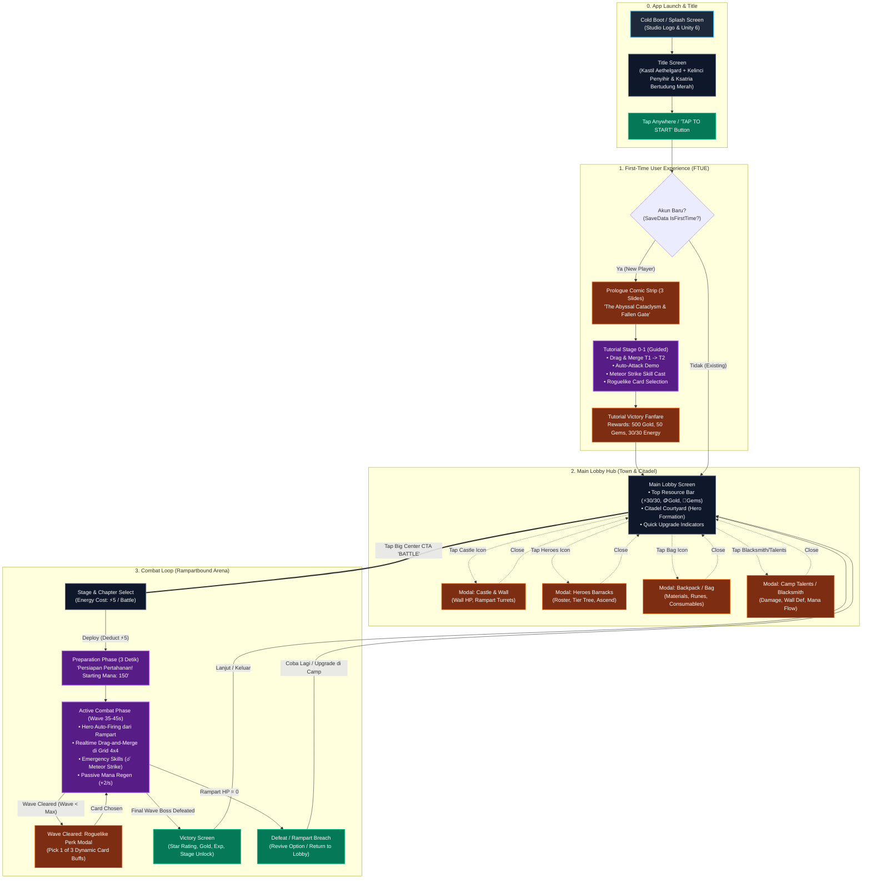
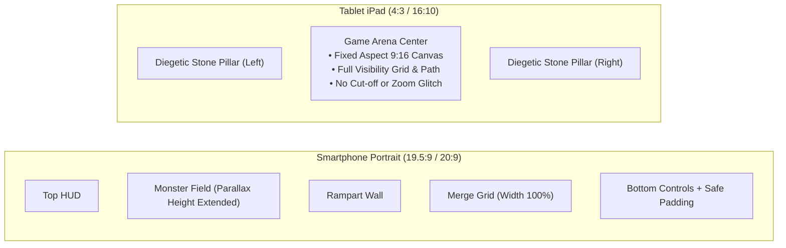
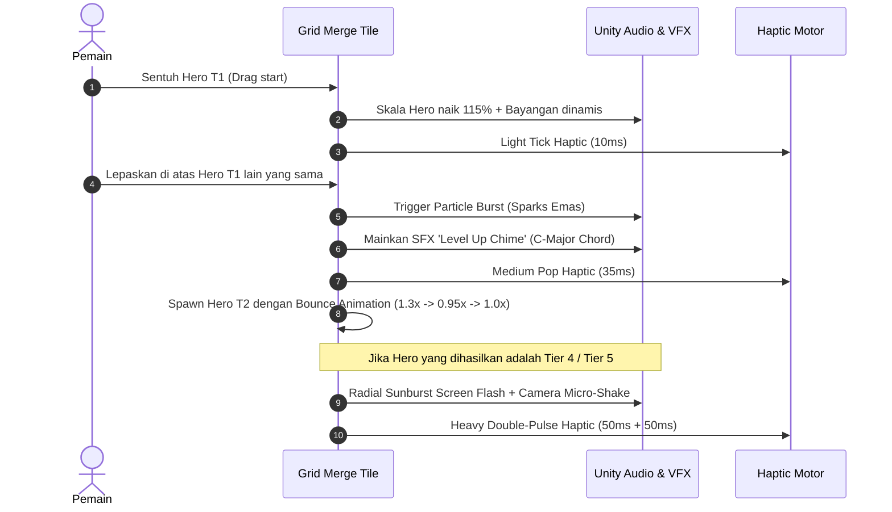
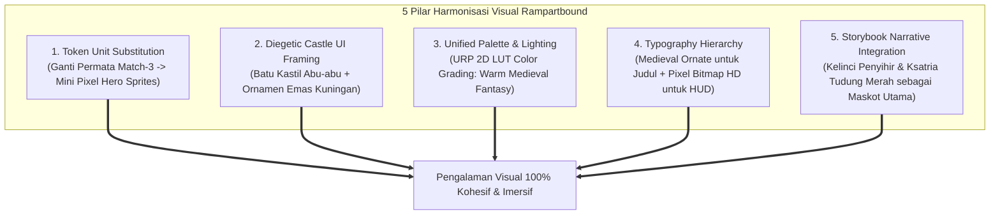

# Rampartbound: Pixel Defense — Master UI/UX Design & Flow Document
**Document Version:** 1.0.0 (Production Master)  
**Role / Author:** UX Specialist & UI Designer (`ux_specialist` / `ui_designer`)  
**Target Platform:** Mobile First (Android & iOS — Portrait Orientation 9:16 / 19.5:9 / 20:9, Adaptasi Tablet iPad 4:3 & 16:10)  
**Engine & Pipeline:** Unity 6 (URP 2D, Canvas Scaler Match-Width, 2D Lights)  
**Status:** Approved for Implementation  

---

## Executive Summary
Dokumen ini menetapkan standar arsitektur UI/UX resmi untuk game mobile **Rampartbound: Pixel Defense**. Fokus utama dokumen ini adalah menciptakan *flow* pengalaman bermain yang mulus (*frictionless*), tata letak kontrol jempol satu tangan yang ergonomis (*single-handed thumb ergonomics*), kepastian hierarki resource ekonomi (konfirmasi zero roti & zero kayu), visual juice yang memuaskan, serta penyelesaian masalah inkonsistensi visual (*art style gap*) antara Title Screen, Main Lobby, dan Battle Board.

---

## 1. User Journey & Screen Flowchart

### 1.1 Tahapan User Journey Lengkap



---

### 1.2 Detail Breakdown Tiap Layar

#### A. Title Screen (The Gateway to Aethelgard)
* **Karakter & Elemen Visual:**
  - Sisi Kiri Bawah: **Kelinci Penyihir (Arcane Bunny Mage)** bertopi penyihir biru runcing dengan tongkat sihir berapi lembut.
  - Sisi Kanan Bawah: **Ksatria Bertudung Merah (Red-Hooded Knight)** dengan jubah merah, pelindung dada perak, pedang, dan perisai berpermata biru.
  - Pusat Atas: **Benteng Kastil Megah** berlatar pegunungan hijau, pohon pinus, dan langit biru berawan cerah.
  - Di Atas Kastil: **Kubus Relik Arcane (The Mystic Core)** melayang dengan ukiran rune magis yang berputar halus (*subtle idle floating particle*).
  - Logo Game: Emblema emas bertatahkan kristal perisai *Rampartbound*.
* **Interaksi Utama:**
  - Tombol **"TAP TO START"** terletak di zona tengah-bawah yang empuk (*pill button* emas bertepi batu permata biru).
  - Tombol berdenyut (*breathing glow animation*, skala $1.0 \leftrightarrow 1.05$).
  - Begitu disentuh: Suara gemerincing kristal (*crystal chime SFX*) + getaran haptic ringan (*Light Haptic*) + transisi fade-out iris melingkar menuju FTUE atau Main Lobby.

#### B. First-Time User Experience (FTUE)
* **Durasi Target:** $\le 120$ detik dari cold launch hingga pemain memenangkan wave pertama.
* **Prinsip Anti-Boredom:**
  - Tidak ada teks tutorial panjang berparagraf.
  - Semua instruksi menggunakan *Direct Gestural Guidance* (jari animasi memandu drag & drop).
* **Alur Langkah FTUE:**
  1. **Langkah 1 (Summon Pertama):** Jari memandu menekan tombol "Summon" di kiri bawah. Unit *Novice Archer (Tier 1)* muncul di petak grid.
  2. **Langkah 2 (Summon Kedua):** Jari memandu summon unit kedua di petak sebelahnya.
  3. **Langkah 3 (The First Merge):** Jari memandu drag Archer 1 ke Archer 2. Efek kilatan cahaya emas + haptic medium + suara "Level Up!" melahirkan *Scout Sniper (Tier 2)*.
  4. **Langkah 4 (Combat Observation):** Gerombolan Slime pertama memasuki jangkauan benteng. Scout Sniper menembak otomatis ke arah musuh. Pemain menyaksikan HP bar musuh menyusut.
  5. **Langkah 5 (Tactical Agency):** Teks peringatan "Gelombang Slime Mendekat!" muncul. Tombol ☄️ *Meteor Strike* menyala terang. Pemain menekan tombol untuk membakar area musuh.
  6. **Langkah 6 (Roguelike Card Intro):** Wave 1 selesai. Layar melambat dramatis (*slow motion*), muncul 3 kartu pilihan berkah. Pemain memilih kartu *Swift Fingers (+20% Atk Speed)*.
  7. **Langkah 7 (Victory & Onboarding Reward):** Pemain memenangkan pertempuran tutorial, mendapatkan 500 Gold, 50 Gems, dan langsung diarahkan ke Main Lobby dengan rasa puas dan paham kontrol dasar.

#### C. Main Lobby Hub (Town & Citadel)
* **Fungsi:** Pusat retensi harian, upgrade talenta, manajemen hero, dan pintu masuk menuju pertempuran.
* **Komposisi Layar:**
  - **Atas:** Top Resource Bar terintegrasi (Profile, Level, ⚡ Energi, 🪙 Koin Emas, 💎 Permata, Settings, Mail).
  - **Tengah:** Area halaman benteng (Citadel Courtyard) menampilkan 3 Hero Utama yang sedang bertugas (*Arthur, Lena, Eldon*), tenda pasukan, dan bengkel tempa dengan indikator balon notifikasi upgrade jika koin mencukupi.
  - **Bawah:** Fixed Bottom Navigation Dock dengan 5 tombol navigasi utama:
    - `[CASTLE]` : Upgrade benteng, durabilitas tembok, dan senjata meriam dinding.
    - `[HEROES]` : Galeri kartu hero, kenaikan bintang (*ascend*), dan pohon evolusi tier.
    - `[BATTLE]` : Tombol CTA utama (terbesar di tengah, menonjol dengan efek api/emblem pedang bersilang).
    - `[BAG]` : Penyimpanan material, shard hero, dan tiket energi.
    - `[TALENTS / GUILD]` : Bengkel Talenta Blacksmith untuk upgrade stat pasif global.

#### D. Layar Pertempuran (The Combat Arena)
* **Fungsi:** Medan perang tempat bertemunya jalur serbuan monster dengan tembok benteng pertahanan dan grid merge.
* **Hierarki Vertikal:**
  1. **Top HUD (0% - 15% Screen Height):** Wave Counter (misal `Wave 3/10`), Base Rampart HP Bar (`100/100`), Timer / Pause Button.
  2. **Monster Battlefield (15% - 45% Screen Height):** Area padang rumput tempat monster bergerak turun menuju benteng.
  3. **The Rampart Barrier (45% - 52% Screen Height):** Dinding batu benteng berpalisade kokoh tempat meriam dan proyektil ditembakkan.
  4. **Merge Grid Board (52% - 85% Screen Height):** Grid 4x4 (16 petak) tempat hero ditempatkan dan di-merge secara aktif.
  5. **Bottom Action Footer (85% - 100% Screen Height):** Tombol Summon Hero (dengan indikator biaya mana), Mana Pool Bar, dan tombol Active Emergency Skill (Meteor Strike).

---

## 2. Analisis Ergonomi Layar Mobile (Thumb-Zone & Touch Targets)

### 2.1 Peta Jangkauan Jempol Satu Tangan (Portrait Mobile Ergonomics)

Mengacu pada studi ergonomi perangkat genggam mobile (*Steven Hoober Mobile Reach Study* & *Apple/Google Ergonomic Guidelines*), mayoritas pengguna mengoperasikan ponsel portrait menggunakan satu tangan (jempol kanan atau jempol kiri).

```text
+------------------------------------------+  0%  - HARD TO REACH (DANGER ZONE)
|  [Avatar/Lv]    [⚡ 30/30]    [🪙 12,450] |      • Hanya untuk info pasif & read-only
|  [Wave 1/10]              [⏸️ Pause/Opt] |      • Tombol jarang ditekan (Settings, Pause)
+------------------------------------------+ 15%
|                                          |
|         MONSTER SPAWN & FIELD            |      - STRETCH ZONE (JANGKAUAN SEDANG)
|     👾 Slime           👹 Goblin         |      • Area observasi pertempuran visual
|           ↓                ↓             |      • Area tembakan proyektil & VFX
|                                          |
+==========================================+ 45%
|         RAMPART WALL / DEFENSE           |      - INTERMEDIATE ACTIVE ZONE
+==========================================+ 50%
|    [ 🏹 T1 ]  [ 🧙 T2 ]  [ 🛡️ T1 ]  [   ]  |
|    [       ]  [ 🏹 T1 ]  [ 🧙 T3 ]  [   ]  |      - NATURAL THUMB ZONE (ZONA NYAMAN)
|    [ 🛡️ T2 ]  [       ]  [ 🏹 T2 ]  [   ]  |      • Area manipulasi grid 4x4 (Drag & Merge)
|    [       ]  [ 🧙 T1 ]  [       ]  [   ]  |      • Respon cepat jempol tanpa geser genggaman
+------------------------------------------+ 85%
|  [ ⚡ SUMMON ]      [ ☄️ METEOR SKILL ]   |      - PRIMARY CTA ZONE (BOTTOM FOOTER)
|   (100 Mana)         (Cooldown: 20s)     |      • Jangkauan jempol paling rileks & instan
+------------------------------------------+ 95%
|          [ SAFE AREA HOME BAR ]          | 100% - PROTECTED MARGIN (Zero Interactive UI)
+------------------------------------------+
```

#### Pembagian Zona Ergonomi:
1. **Natural Thumb Zone (Zona Hijau / Alami — 50% hingga 88% Tinggi Layar):**
   - **Elemen:** Papan Grid Merge 4x4, Tombol `SUMMON HERO`, Tombol `☄️ METEOR STRIKE`.
   - **Karakteristik UX:** Pemain dapat menjangkau seluruh petak grid dan tombol summon hanya dengan rotasi sendi ibu jari tanpa meregangkan telapak tangan (*no grip strain*).
2. **Stretch Zone (Zona Kuning / Jangkauan Sedang — 20% hingga 50% Tinggi Layar):**
   - **Elemen:** Jalur monster, dinding rampart, indikator HP benteng.
   - **Karakteristik UX:** Area ini terutama adalah area visual (konsumsi informasi optik). Interaksi sentuhan langsung jarang terjadi, kecuali jika pemain ingin melihat detail monster dengan tap sesekali.
3. **Hard-to-Reach Zone (Zona Merah / Ekstrem — 0% hingga 20% Tinggi Layar):**
   - **Elemen:** Top Resource Bar (⚡ Energi, 🪙 Koin Emas, 💎 Permata), Pause Button, Tombol Pengaturan.
   - **Karakteristik UX:** Disengaja diletakkan di atas agar **tidak sengaja tertekan (*anti-accidental touch*)** saat jempol lincah melakukan drag-and-merge di bagian bawah.

---

### 2.2 Dimensi Minimum Touch Targets & Spacing Standard

Untuk mencegah kesalahan input (*fat-finger error*), seluruh target sentuh diatur sesuai standar internasional:

| Komponen UI | Ukuran Fisik Minimum (Android) | Ukuran Fisik Minimum (iOS) | Padding / Deadzone | Standar Rampartbound |
|---|---|---|---|---|
| **Tombol CTA Utama** (`BATTLE`, `SUMMON`) | $48 \times 48\text{ dp}$ | $44 \times 44\text{ pt}$ | $12\text{ dp}$ | **$64 \times 64\text{ dp}$ (Pill shape)** |
| **Grid Slot Tile** (Petak Merge 4x4) | $56 \times 56\text{ dp}$ | $52 \times 52\text{ pt}$ | $8\text{ dp}$ antar slot | **$68 \times 68\text{ dp}$ (Square rounded)** |
| **Emergency Skill Button** (`Meteor`) | $48 \times 48\text{ dp}$ | $44 \times 44\text{ pt}$ | $10\text{ dp}$ | **$56 \times 56\text{ dp}$ (Circular badge)** |
| **Top Bar Currency Pill** | $40 \times 80\text{ dp}$ | $38 \times 76\text{ pt}$ | $6\text{ dp}$ | **$42 \times 96\text{ dp}$ (Rounded capsule)** |
| **Nav Dock Buttons** (`Castle`, `Heroes`, dll.) | $48 \times 48\text{ dp}$ | $44 \times 44\text{ pt}$ | $4\text{ dp}$ | **$54 \times 54\text{ dp}$** |
| **Close Modal 'X' Button** | $44 \times 44\text{ dp}$ | $44 \times 44\text{ pt}$ | $8\text{ dp}$ | **$48 \times 48\text{ dp}$ (Top-right anchor)** |

---

### 2.3 Safe Area & Display Cutout Adaptation (Android & iOS)

Ponsel modern memiliki berbagai gangguan fisik layar: Dynamic Island & Notch pada iPhone, punch-hole kamera pada Android, serta Home Bar gesture di bagian bawah.

```text
                  [ DYNAMIC ISLAND / PUNCH-HOLE ]
           ┌───────────────────────────────────────────┐
           │ < - - - - - TOP SAFE PADDING - - - - - - >│ min 48-59 pt
           │  [Avatar]    [⚡ 30/30]     [🪙 12,450]    │
           ├───────────────────────────────────────────┤
           │                                           │
           │               CONTENT CANVAS              │
           │                                           │
           ├───────────────────────────────────────────┤
           │  [CASTLE]  [HEROES]  [BATTLE]  [BAG] [TAL]│
           │ < - - - - BOTTOM SAFE PADDING - - - - - - > min 34 pt
           └───────────────────────────────────────────┘
                       ═══════ HOME BAR ═══════
```

1. **Top Safe Area Handling:**
   - Offset atas minimal **48 pt (Android)** dan **59 pt (iPhone 14/15/16 Pro)**.
   - Resource Bar dipasang pada *SafeArea Container Layout* dengan constraint script `SafeCanvasArea.cs`. Latar belakang langit/atap kastil tetap dirender *full-bleed* ke tepi atas fisik layar, tetapi elemen teks dan tombol tidak boleh bersentuhan dengan lubang kamera.
2. **Bottom Safe Area Handling:**
   - Offset bawah minimal **34 pt (iOS Home Bar Indicator)** dan **24-32 dp (Android Gesture Navigation)**.
   - Tombol Summon Hero dan Bottom Nav Dock memiliki margin bawah aman minimal 36 pt. Hal ini mencegah terjadinya *accidental home swipe* (kembali ke beranda HP saat berniat menekan tombol summon atau merge di baris terbawah).

---

### 2.4 Adaptasi Multi-Platform: Layar Panjang (19.5:9, 20:9) vs Tablet iPad (4:3, 16:10)

Game hybrid merge sering mengalami masalah layout ketika berpindah dari smartphone berlayar ramping (20:9) ke tablet iPad yang lebar (4:3).



#### Strategi Solusi Responsif Unity:
* **Canvas Scaler Mode:** Diatur ke `Scale With Screen Size`, Reference Resolution: `1080 x 1920`, Screen Match Mode: `Match Width Or Height` dengan slider **Match = 0 (Match Width)** untuk Smartphone portrait.
* **Solusi Khusus iPad (4:3 / 16:10):**
  - **Masalah:** Jika hanya mencocokkan lebar (*width*), tinggi layar iPad yang pendek akan memotong bagian monster spawner atau tombol bawah (*vertical clipping*).
  - **Solusi Rampartbound (Diegetic Pillar Framing):**
    - Kamera 2D diatur dengan *Dynamic Orthographic Size Calculation* berdasarkan aspect ratio target.
    - Pada rasio 4:3, area tengah dipertahankan pada proporsi ideal gameplay, sementara ruang ekstra di sayap kiri dan kanan dihiasi dengan **"Diegetic Stone Bastion Pillars"** (ukiran pilar benteng batu kastil abad pertengahan dengan obor api berkobar).
    - Hasil: Tampilan terlihat megah, tidak terpotong, dan mempertahankan nuansa kastil yang kohesif tanpa letterbox hitam murahan.

---

## 3. UI Design System & Component Library

### 3.1 Top Resource Bar System (Zero Roti & Zero Kayu Confirmed)

> [!IMPORTANT]
> **Kepastian Regulasi Ekonomi UI:** Sesuai arah game design resmi, game ini **TIDAK MENGGUNAKAN** resource Roti maupun Kayu (*Zero Bread & Zero Wood*).
> Resource bar hanya menampilkan 3 aset ekonomi utama yang bersih, berbobot, dan tidak membingungkan pemain.

```text
+-----------------------------------------------------------------------------------+
| [Lv.14]   [ ⚡ ENERGI: 30/30  (+) ]   [ 🪙 EMAS: 45,670 (+) ]   [ 💎 GEMS: 250 (+) ] |
+-----------------------------------------------------------------------------------+
```

#### Spesifikasi Detail Komponen Resource Bar:

| Resource Item | Ikon Visual | Representasi Teks | Mekanika & Regenerasi | Aksi Saat Ditap |
|---|---|---|---|---|
| **⚡ Energi Benteng (Stamina)** | Petir Neon Emas berbingkai kuningan | `30/30` (Maksimal 30) | • Biaya: 5 Energi / Battle (Total 6 Battle per Full Bar)<br/>• Regen: +1 Energi tiap 8 menit (Full dalam 4 jam) | Membuka popup timer pemulihan energi & opsi beli instan via Gems / Nonton Iklan |
| **🪙 Koin Emas (Gold)** | Keping Emas Kerajaan bergambar perisai | Format angka ribuan: `45,670` | Mata uang dasar pertempuran & reward wave. Digunakan untuk upgrade Blacksmith & Talenta benteng. | Membuka konversi Gems ke Koin Emas |
| **💎 Permata Abyssal (Gems)** | Kristal Safir Biru berpendar | Format angka: `250` | Premium currency dari first-clear stage, quest mingguan, atau in-app purchase. | Membuka Toko Permata (Gem Shop) |
| **👑 Level Akun & Bar EXP** | Mahkota perak berangka emas (`Lv.14`) | Baris progress mini di bawah avatar | EXP diperoleh dari menyelesaikan stage. Naik level memberikan bonus refuel energi penuh. | Membuka detail profil pemain & statistik rekor kemenangan |

---

### 3.2 Floating Modals Architecture

Semua jendela pop-up dan menu sekunder dirancang sebagai **Floating Modals** dengan latar belakang semi-transparan (*Backdrop Dim 75% Black + Fast Dual Blur Shader*). Jendela memiliki bingkai batu kastil abu-abu gelap dengan ornamen sudutan kuningan tempa (*Ornate Brass Trim*).

#### A. Modal: Castle & Rampart Fortifications
* **Tujuan:** Memperkuat dinding benteng yang menahan serbuan monster.
* **Konten Tampilan:**
  - Status Durabilitas Dinding: Bar HP Dasar Benteng (misal `Base HP: 1,500 / 1,500`).
  - Slot Senjata Benteng:
    - Slot Kiri: **Heavy Mortar Cannon** (Level & Upgrade Button).
    - Slot Kanan: **Repeating Ballista Crossbow** (Level & Upgrade Button).
  - Tombol Upgrade: Biaya koin emas dengan indikator kenaikan atribut (+HP, +Armor, +Thorns Damage).

#### B. Modal: Heroes Barracks
* **Tujuan:** Menampilkan koleksi hero pemain dan jalur evolusi merge mereka.
* **Konten Tampilan:**
  - Kartu Roster Hero: Menampilkan siluet dan sprite 5 Tier Hero:
    - *Tier 1: Novice Archer*
    - *Tier 2: Scout Sniper*
    - *Tier 3: Arcane Mage*
    - *Tier 4: Heavy Cannoner*
    - *Tier 5: Storm Sorcerer*
  - Kartu menampilkan DPS dasar, Attack Range, Attack Speed, dan Efek Status (Stun, AoE, Shock Chain).
  - Tombol **"Ascend Hero"** untuk meningkatkan stat dasar permanen menggunakan Hero Shards.

#### C. Modal: Backpack / Bag (Inventory)
* **Tujuan:** Menyimpan item inventaris pemain tanpa clutter.
* **Tab Navigasi Modal:**
  - Tab 1: **Runes & Core Artifacts** (Kristal relik penguat tim).
  - Tab 2: **Crafting Materials** (Batu asah tempa, besi benteng, scroll sihir).
  - Tab 3: **Consumables** (Potion Energi Instan, Tiket Auto-Clear).

#### D. Modal: In-Battle Roguelike Perks (Pilihan Kartu Wave)
* **Tujuan:** Memberikan sensasi pilihan taktis roguelike setiap gelombang monster berhasil dibersihkan.
* **Struktur Kartu:** 3 Kartu Berdampingan (*Card Carousel / Trio Cards*) dengan border emas foil menyala:
  1. *Swift Fingers:* Ikon busur berangin hijau — `+20% Attack Speed seluruh hero di papan`.
  2. *Heavy Arrows:* Ikon mata panah menembus batu — `+25% Base Projectile Damage`.
  3. *Mage Mastery:* Ikon bola orb arcane ungu — `Peluru sihir memiliki 30% peluang Critical Damage (2x)`.
  4. *Fortify Wall:* Ikon perisai menyala hijau — `Memulihkan 30% HP Benteng secara instan`.
  5. *Mana Overflow:* Ikon botol mana meluap — `Biaya Summon Hero berikutnya berkurang 25%`.
* **Animasi:** Kartu muncul dari dasar layar dengan animasi flip 3D (*Y-axis 90° -> 0°*) disertai partikel debu emas magis.

---

### 3.3 Visual Juice, Micro-Interactions & Sensory Feedback

Untuk membuat *gameplay loop* terasa renyah (*satisfying & addictive*), diterapkan sistem feedback multisensori:



#### Matriks Feedback Multisensori:

| Event Aksi Pemain | Animasi / Visual Juice | Efek Audio (SFX) | Respon Haptic (Getaran) |
|---|---|---|---|
| **Tap Tombol Umum** | Tombol mengecil (*Press Scale: 0.92x*), kembali empuk dalam 0.1s (*Spring Elastic*) | Soft Click kayu ringan | Light Haptic (10ms) |
| **Pilih / Angkat Unit di Grid** | Sprite membesar 115%, sedikit transparan (alpha 0.8), petak valid lain menyala hijau lembut | Suara angkat 'Whoosh' mikro | Micro Tick (8ms) |
| **Penggabungan Unit (Merge Success)** | Bintang-bintang partikel meletup, unit berputar sebentar lalu membesar elastis (*Punch Scale: 1.25x*) | Harmonic Chord (Nada naik sesuai tingkatan Tier) | Medium Impact (35ms) |
| **Summon Hero Baru** | Portal sihir mini biru berputar di petak kosong, unit muncul dari cahaya vertikal | Suara 'Poof' magis bervolume hangat | Soft Bump (20ms) |
| **Tembakan Proyektil Kena Musuh** | Musuh berkedip putih (*White Sprite Flash 0.04s*), angka damage melayang melengkung | Tembakan busur 'Thwip' / Ledakan 'Boom' tumpul | Tidak ada (agar tidak menguras baterai HP) |
| **Benteng Tertabrak Monster** | Layar bergetar (*Camera Shake: Amplitude 0.15, Duration 0.18s*), border layar flash merah tipis | Suara retakan batu tebal | Heavy Warning Haptic (60ms) |
| **Aktivasi Skill Meteor** | Bayangan meteor jatuh dari langit atas, ledakan api radial membakar tanah | Suara raungan api mendalam (*Sub-bass Boom*) | Heavy Rumbling Haptic (100ms) |

---

## 4. Analisis Gap & Desain Visual yang Masih 'Miss'

### 4.1 Audit Inkonsistensi Visual Saat Ini (The Current Visual Mismatch)

Setelah mengaudit seluruh aset gambar produksi di repositori (`TitleScreen.jpg`, `MainLobby.jpg`, `BattleField.jpg`, `Village_Reference.jpg`, dan `Gameplay.jpeg`), tim menemukan **3 perbedaan gaya seni (*art style divergence*) yang mencolok**:

```text
+-----------------------+      +-----------------------+      +-----------------------+
|     START SCREEN      |      |     VILLAGE LOBBY     |      |     BATTLE BOARD      |
|  (TitleScreen.jpg)    |      | (Village_Reference)   |      |  (BattleField.jpg)    |
+-----------------------+      +-----------------------+      +-----------------------+
| • Digital Painting    |  !=  | • 16-Bit Retro Pixel  |  !=  | • Casual Match-3 Gem  |
| • Chibi Anime Stylized|      | • Isometric SNES/GBA  |      | • Flat Vector Grass   |
| • Smooth Lines        |      | • RPG Tile Density    |      | • Non-Combat Avatars  |
+-----------------------+      +-----------------------+      +-----------------------+
           ▲                                                              ▲
           └────────────────── JURANG KONSISTENSI ────────────────────────┘
```

#### Uraian Temuan Masalah Spesifik:
1. **Title Screen (`TitleScreen.jpg`):**
   - **Gaya:** Ilustrasi Full Digital Painting / Chibi Storybook dengan garis bersih (*clean line-art*) dan *soft shading*. Menampilkan karakter heroik imut: Ksatria Bertudung Merah dan Kelinci Penyihir.
   - **Kesan:** Game petualangan fantasi premium dengan narasi yang kuat.
2. **Main Lobby & Desa (`MainLobby.jpg` vs `Village_Reference.jpg`):**
   - Di `Village_Reference.jpg` (referensi *Crownstone Survival*): Gaya adalah **16-bit Isometric Dense Pixel Art** khas era GBA/SNES lengkap dengan bengkel tempa, kincir air, dan sumur batu. Terdapat pula elemen resource basi (kayu dan roti) dari game lain.
   - Di `MainLobby.jpg`: Gaya berganti menjadi **2D Cartoon Vector** (mirip game mobile kasual barat) dengan cacat visual berupa header resource ganda di bagian atas (*patchy glitch*).
3. **Papan Tempur (`BattleField.jpg` & `Gameplay.jpeg`):**
   - **Gaya:** Grid menampilkan **Permata Faset 3D Match-3 (Permata Hati, Daun, Berlian) dan Kepala Boneka Hewan (Kucing, Anak Ayam, Ninja)** di atas latar rumput hijau datar.
   - **Ketidaksesuaian Kritis:** Ini bertentangan dengan Game Design Document (GDD) resmi *Rampartbound: Pixel Defense*, yang menetapkan bahwa unit di grid adalah **Prajurit Pixel Defense yang menembak (Novice Archer, Arcane Mage, Cannoner)**, BUKAN permata puzzle Match-3 kasual permen!

#### Dampak Negatif terhadap UX & Retensi:
* **Disonansi Kognitif (*Expectation Mismatch*):** Pemain mengunduh game karena terpikat ilustrasi ksatria & penyihir di cover/title screen, tetapi saat bertempur mereka disajikan gameplay permen/permata kasual yang terlihat seperti prototipe mentah.
* **Persepsi "Asset Flip":** Perbedaan radikal antara layar judul (kartun lukis), desa (pixel isometric), dan medan tempur (permata puzzle) membuat game terasa seperti rakitan aset lepas tanpa pengarahan seni (*art direction*) yang solid.

> [!NOTE]
> **Status Resolusi Resmi (v2.6.0):** Sesuai instruksi resmi Pemilik Proyek, **Gambar 2A (`MainLobby.jpg`) dan Gambar 2B (`Village_Reference.jpg`) telah DIHAPUS SEPENUHNYA 100%**. Main Lobby kini telah di-redesign secara total (`lobby_mockup_redesign.jpg`) menampilkan seluruh pahlawan kanonikal Chibi Anime (**Pippin**, **Cedric**, **Commander Rose**, **Ignis**, dan **Barney**) dengan kanvas mobile portrait 9:16 yang mewah, harmonis dengan Title Screen, dan bebas 100% dari aset usang roti/kayu.

---

### 4.2 Solusi Harmonisasi Desain (The Cohesion Master Plan)

Untuk mencapai standar visual game mobile berkualitas tinggi (*benchmark: Dead Cells, Soul Knight, Eastward, Guardian Tales*), berikut 5 langkah harmonisasi yang wajib dieksekusi:



#### 1. Token Unit Substitution (Penggantian Total Unit Grid)
* **Tindakan:** Hapus seluruh sprite permata faset dan ikon kepala hewan kasual dari papan tempur.
* **Pengganti:** Tempatkan **Sprite Pixel Art Animasi Karakter Hero** di setiap petak grid di atas pedestal kayu bundar:
  - *Tier 1:* Novice Archer (Sprite pemanah berbusur pendek kayu dengan animasi idle memegang anak panah).
  - *Tier 2:* Scout Sniper (Pemanah bertudung dengan busur komposit panjang).
  - *Tier 3:* Arcane Mage (Penyihir beruba jubah biru dengan orb sihir berpendar).
  - *Tier 4:* Heavy Cannoner (Prajurit berhelm baja mengoperasikan meriam mini).
  - *Tier 5:* Storm Sorcerer (Penyihir petir dengan kilatan listrik di jubahnya).
* **Indikator Tier:** Sudut kanan bawah tiap petak diberi badge bintang tier kecil perunggu/perak/emas yang jelas terbaca.

#### 2. Diegetic Castle UI Framing (Bingkai Antarmuka Tematik)
* **Tindakan:** Standarisasi seluruh frame UI (Header Bar, Floating Modals, Card Frames, Grid Board, Footer) menggunakan material tematik tunggal:
  - **Material Utama:** Blok Batu Kastil Aethelgard (*Blue-Grey Slate Stone*) dengan aksen sambungan semen tipis.
  - **Sudut & Lis:** Kuningan/Perunggu tempa berpahat (*Ornate Forged Brass Corners*).
  - **Latar Modal:** Tekstur perkamen kulit tua (*Aged Parchment Texture*) dengan kontras tinggi untuk teks deskripsi.

#### 3. Color Grading & URP 2D Unified Lighting
* **Tindakan:** Menggunakan pipeline URP 2D Unity untuk menyatukan nuansa visual di semua scene:
  - **Global Volume LUT:** Terapkan color grading palet hangat: *Mid-day Medieval Sunlight* (sedikit tint keemasan pada highlight dan saturasi hijau pinus alami).
  - **2D Point Lights:** Tambahkan efek pencahayaan 2D dinamis pada api obor dinding benteng dan kubus relik di medan tempur. Ini menjembatani ilustrasi halus dan pixel art sehingga terasa berada di dunia fisik yang sama.

#### 4. Tipografi & Ikonografi Standar Industri
* **Tindakan:** Standarisasi font sistem ke dalam 2 keluarga font:
  - **Header & Title Font:** *Cinzel Decorative* atau *Medieval Sharp* (untuk Title Screen, Nama Chapter, Popup Kemenangan, Label Modal).
  - **In-Game HUD & Number Font:** *Silver Pixel / Retro Gaming HD* (font bitmap beresolusi tinggi dengan outline hitam 1px agar terbaca tajam pada ukuran layar kecil untuk Damage Numbers, Wave Timer, Mana, dan Koin).

#### 5. Storybook Narrative Anchor (Integrasi Maskot Hero)
* **Tindakan:** Hubungkan karakter dari Title Screen ke dalam game loop:
  - **Kelinci Penyihir (Bunny Wizard):** Dijadikan narator pemandu tutorial (FTUE NPC), maskot pengumuman event harian, dan hero khusus evolusi sihir.
  - **Ksatria Bertudung Merah (Red Hood Knight):** Dijadikan komandan garnisun di Main Lobby dan hero petarung garis depan di dinding benteng.
  - **Kubus Relik Arcane (The Relic Core):** Ditempatkan di tengah belakang dinding benteng sebagai sumber energi pertahanan benteng yang mengeluarkan gelombang denial saat pemain mengaktifkan skill darurat.

---

## 5. Matriks Komponen UI & Token Design System

Untuk memudahkan tim engineering (`game_developer`) dan QA (`qa_visual_auditor`) dalam implementasi langsung pada Unity UI Canvas:

```text
================================================================================
RAMPARTBOUND UI TOKENS & SYSTEM GUIDELINE
================================================================================
[COLORS]
Primary Stone Dark   : #1E232A (Background modal & panel base)
Primary Stone Light  : #333B47 (Card slot & grid cell unselected)
Accent Gold Border   : #D4AF37 (Ornate trim & active selection)
Accent Gold Glow     : #FFD700 (High-priority CTA & Level up aura)
Abyssal Cyan/Blue    : #00D2FF (Mana bar, Arcane Mage, Gems)
Rampart HP Green     : #2ECC71 (Healthy base wall)
Rampart HP Danger    : #E74C3C (Critically damaged wall < 25%)
Text Title Parchment : #FDF6E2 (Teks judul & angka emas)
Text Body Subtitle   : #C2C9D6 (Deskripsi talent & card effect)

[FONTS]
Headings / Banner    : "MedievalSharp-Bold", Sans-Fallback
HUD / Numbers / Digit: "Silver-Pixel-HD", Monospace-Fallback

[CANVAS SCALER PRESETS]
Target Resolution    : 1080 x 1920 (9:16 Reference Portrait)
Scaler Mode          : ScaleWithScreenSize
Match Mode           : Width (0.0) on Phone, Camera Ortho Expand on Tablet (4:3)
================================================================================
```

---

## 6. Verifikasi & Langkah Tindak Lanjut Tim (Next Action Steps)

1. **Untuk Mobile UI Designer (`ui_designer`):**
   - Menyiapkan atlas sprite UI: Frame Batu Kastil, Pill Resource Bar (⚡, 🪙, 💎), Tombol Navigasi 5-Dock, dan Template Kartu Perk Roguelike.
2. **Untuk Character Artist (`character_artist`):**
   - Mengganti aset permata Match-3 di grid menjadi sprite sheet karakter 16-bit pixel unit (Novice Archer T1 hingga Storm Sorcerer T5) berukuran $48 \times 48\text{ px}$.
3. **Untuk Core Game Developer (`game_developer`):**
   - Mengintegrasikan alur `SafeCanvasArea.cs` untuk Dynamic Island/Home Bar padding.
   - Memastikan `LobbyUIManager.cs` hanya menampilkan Energi 30/30, Koin Emas, dan Permata (bersih tanpa sisa variabel roti/kayu).
4. **Untuk Dual QA Gatekeepers:**
   - `qa_functional_gatekeeper`: Menguji stabilitas transisi state FTUE -> Lobby -> Battle -> Perk Modal -> Victory.
   - `qa_visual_auditor`: Menguji touch target size ($\ge 48\text{ dp}$), ketiadaan overlap teks di rasio 19.5:9 dan 4:3, serta keselarasan palet warna.
