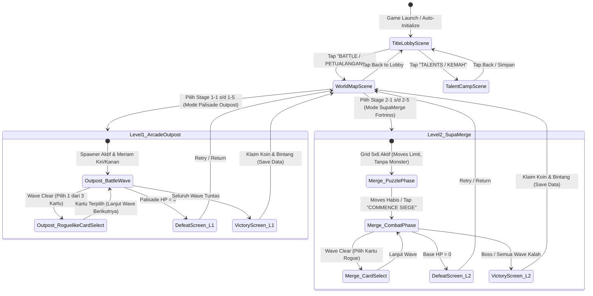

# Spesifikasi Arsitektur: Scene State Machine, Event Flow & Save Data Schema
**Rampartbound: Pixel Defense — Single Source of Truth Technical Architecture**  
**Dokumen:** `GameDesign/SCENE_STATE_MACHINE_AND_SAVE_DATA_SPEC.md`  
**Divisi Penanggung Jawab:** Divisi 2 (System Analysis — `system_analyst` / BA/SA)  
**Versi Dokumen:** v1.0.0 (Selaras SSOT Master Spec v2.14.0)

---

## 1. Alur State Machine Scene (Scene Transition Flow)

Sistem alur transisi game menggunakan arsitektur modular yang memisahkan scene lobi, peta petualangan, dan dua mode pertempuran yang berbeda secara mekanik.



---

## 2. Event-Driven Messaging Contract (Game Events)

Untuk menjaga *decoupled architecture* tanpa dependensi sirkular, sistem menggunakan Event Bus C#:

| Event Name | Parameter | Triggered By | Handled By |
|---|---|---|---|
| `OnSceneTransitionRequested` | `string targetSceneName` | UI Buttons | `GameSceneController` |
| `OnStageStarted` | `int stageId, int levelMode` | `LevelManager` | `WaveManager`, `GridManager`, `AudioManager` |
| `OnWaveCompleted` | `int currentWave, int totalWaves` | `WaveManager` | `CardSelectionManager`, `AudioManager` |
| `OnCardSelected` | `string cardId, CardData card` | `CardUIController` | `HeroUnit`, `RampartBase`, `Projectile` |
| `OnHeroMerged` | `int gridX, int gridY, int newTier` | `GridManager` | `MergeItem`, `AudioManager`, `VFXManager` |
| `OnBaseDamageTaken` | `float damage, float remainingHP` | `MonsterController` | `RampartBase`, `HUDController`, `HapticFeedback` |
| `OnStageCleared` | `int starsEarned, int coinsEarned` | `GameManager` | `SaveDataManager`, `VictoryUIController` |
| `OnStageDefeated` | `int waveReached, string cause` | `RampartBase` | `DefeatUIController`, `AudioManager` |

---

## 3. Save Data Specification (Schema JSON & PlayerPrefs)

### A. Lokasi Penyimpanan:
1. **Primary**: `Application.persistentDataPath + "/save_data.json"`
2. **Backup & Security**: Enkripsi hash XOR-HMAC sederhana pada `PlayerPrefs.SetString("PLAYER_SAVE_HASH", ...)` untuk mencegah modifikasi lokal ilegal.

### B. Struktur Data JSON (`save_data.json`):
```json
{
  "save_version": 1,
  "last_saved_timestamp": "2026-10-10T06:55:00Z",
  "player_profile": {
    "player_name": "Defender",
    "account_level": 5,
    "current_exp": 1250,
    "energy": 25,
    "max_energy": 30
  },
  "currencies": {
    "gold_coins": 4500,
    "gems": 120,
    "energy_tokens": 15
  },
  "progression": {
    "max_unlocked_chapter": 2,
    "max_unlocked_stage": 6,
    "stages": {
      "1-1": { "completed": true, "stars": 3, "high_score": 12500 },
      "1-2": { "completed": true, "stars": 3, "high_score": 11800 },
      "1-3": { "completed": true, "stars": 2, "high_score": 9800 },
      "1-4": { "completed": true, "stars": 2, "high_score": 9200 },
      "1-5": { "completed": true, "stars": 1, "high_score": 8500 },
      "2-1": { "completed": false, "stars": 0, "high_score": 0 }
    }
  },
  "talents": {
    "rampart_reinforcement": 3,
    "cannon_powder_mastery": 2,
    "mage_crystal_potency": 2,
    "archery_quick_reload": 1,
    "bounty_coin_magnet": 3
  },
  "heroes_unlocked": {
    "pippin": { "unlocked": true, "rank": 2, "skin_id": "default" },
    "cedric": { "unlocked": true, "rank": 2, "skin_id": "default" },
    "rose": { "unlocked": true, "rank": 1, "skin_id": "default" }
  },
  "audio_settings": {
    "master_volume": 1.0,
    "bgm_volume": 0.65,
    "sfx_volume": 0.85,
    "haptics_enabled": true
  }
}
```

---

## 4. Sertifikasi Analisis Sistem
- **Analisis Kebutuhan**: Sesuai dengan spesifikasi modular multi-level SSOT v2.14.0.
- **Traceability**: Terhubung langsung dengan `LevelManager.cs`, `RampartBase.cs`, `GridManager.cs`, dan `AudioManager.cs`.
