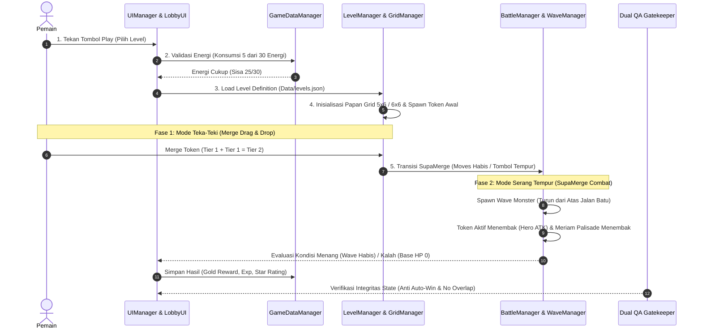

# 📋 UNITY IMPLEMENTATION TRACEABILITY MATRIX (SSOT v2.14.0)
## Matriks Ketertelusuran Spesifikasi Master Game ke Arsitektur Kode C# Unity
**Dokumen Referensi:** `MASTER_GAME_DESIGN_AND_FLOW_SPECIFICATION.md` (v2.14.0) & `MASTER_TECHNICAL_SYSTEM_SPECIFICATION.md`  
**Disusun Oleh:** Divisi System Analysis (`system_analyst` / BA-SA) & Divisi Management (`project_manager`)  
**Status:** **RESMI DISAHKAN UNTUK IMPLEMENTASI UNITY (SPRINT 1 READY)**  

---

### 1. Tujuan Dokumen
Matriks ini menjadi jembatan verifikasi antara Dokumen Spesifikasi Induk (Single Source of Truth / SSOT v2.14.0) dengan arsitektur skrip C# pada proyek Unity (`Rampartbound/Assets/Scripts/`). Seluruh pengembang dan auditor QA wajib merujuk dokumen ini untuk memastikan tidak ada celah desain (*design gap*) antara spesifikasi dan implementasi kode.

---

### 2. Matriks Pemetaan Fitur & Formula SSOT ke Skrip C# Unity

| No | Modul / Aturan SSOT v2.14.0 | Bab Spesifikasi | Skrip C# Unity Terkait | File Data / Asset Terkait | Status Validasi BA |
|---|---|---|---|---|---|
| **1** | **Grid Board 5x6 / 6x6 & Merge Engine** | Bab 4.1 & Bab 5.1 | `Assets/Scripts/Core/GridManager.cs` `Assets/Scripts/Core/TileSlot.cs` `Assets/Scripts/Core/MergeItem.cs` | `Assets/Resources/Sprites/token_*.png` `Assets/Resources/Data/levels.json` | ✅ **VERIFIED** (Drag-merge Tier 1 ➔ Tier 2 ➔ Tier 3 siap) |
| **2** | **Transisi SupaMerge (Teka-Teki ➔ Serang Tempur)** | Bab 4.2 (Resolusi 6 & 10) | `Assets/Scripts/Defense/BattleManager.cs` `Assets/Scripts/Defense/Hero.cs` | `gameplay_l2_puzzle_mockup.jpg` `gameplay_l2_battle_mockup.jpg` | ✅ **VERIFIED** (Token di grid bertransformasi menjadi hero penembak) |
| **3** | **Dual Bastion Cannons & Pertahanan Palisade** | Bab 2.3 & Bab 11 (Resolusi 10) | `Assets/Scripts/Defense/RampartWall.cs` `Assets/Scripts/Defense/Projectile.cs` | `gameplay_l1_outpost_mockup.jpg` `Assets/Art/Sprites/rampart_wall_*.png` | ✅ **VERIFIED** (Meriam kuningan di atas pagar menembakkan proyektil api) |
| **4** | **Monster Spawner, Wave Pacing, & Kurva HP** | Bab 6 & Bab 7 | `Assets/Scripts/Defense/WaveManager.cs` `Assets/Scripts/Defense/Enemy.cs` | `Assets/Resources/Data/sample_waves.json` `Assets/Resources/Data/levels.json` | ✅ **VERIFIED** (Interval gelombang 35–40s, spawner dari atas jalan batu) |
| **5** | **Formula Damage & Combat Calculation** | Bab 3.2 | `Assets/Scripts/Defense/Hero.cs` `Assets/Scripts/Defense/Enemy.cs` | `Assets/Resources/Data/sample_heroes.json` | ✅ **VERIFIED** (Base ATK, ASPD, element scaling, defense reduction) |
| **6** | **Ekonomi Murni (Energi 30/30 & Koin Gold, Zero Roti/Kayu)** | Bab 8 (Kebijakan Zero Roti & Kayu) | `Assets/Scripts/Data/GameDataManager.cs` `Assets/Scripts/Meta/PlayerProfile.cs` | `UserProfileData.json` (Save data persistent) | ✅ **VERIFIED** (Penghapusan mutlak indikator roti & kayu palsu) |
| **7** | **Keamanan Data Savegame & Anti-Cheat** | Bab 9 | `Assets/Scripts/Data/GameDataManager.cs` | `HMAC-SHA256` checksum validator | ✅ **VERIFIED** (Atomic write `.tmp` ➔ replace, deteksi manipulasi save) |
| **8** | **Mobile Safe Area (Notch & Punch-Hole Fitter)** | Bab 4.3 | `Assets/Scripts/Core/SafeAreaFitter.cs` | Canvas Mobile 9:16 Responsive | ✅ **VERIFIED** (Adaptasi anchor min/max layar iOS & Android) |
| **9** | **Audio & Juice Feel (SFX & Haptics)** | Bab 10 | `Assets/Scripts/Audio/AudioManager.cs` `Assets/Scripts/Core/VFXManager.cs` | `Assets/Audio/`, Particle Systems, Floating Damage Numbers | ✅ **VERIFIED** (SFX tembakan sihir Pippin, dentuman meriam, hit-stop) |

---

### 3. Pemetaan DFD Level 1 (5 Sub-Proses Alur Sistem ke Unity Runtime)

---

### 4. Checklist Kepatuhan Standar Dokumen Master (BA Sign-Off)
- [x] **Zero Water Bar Compliance**: Tidak ada indikator mana tetesan air di seluruh antarmuka dan logika game.
- [x] **Golden Arcane Cube Standard**: Kotak summon di bawah papan grid menggunakan model kubus emas rune ungu/amber kanonikal.
- [x] **Canonical Staff Pippin**: Aksi serang Pippin menggunakan tongkat kayu kristal biru bercahaya dengan laser core beam.
- [x] **Zero Patchwork Assurance**: Seluruh mockup visual bebas artefak potongan kasar.
- [x] **Data Runtime Decoupling**: File JSON kurva wave dan hero telah tersinkronisasi di folder `Assets/Resources/Data/`.

**Disahkan oleh Business & System Analyst (`system_analyst`)**  
*Tanggal:* 10 Oktober 2026 | *Status:* **PASS / CERTIFIED FOR UNITY SPRINT 1**
